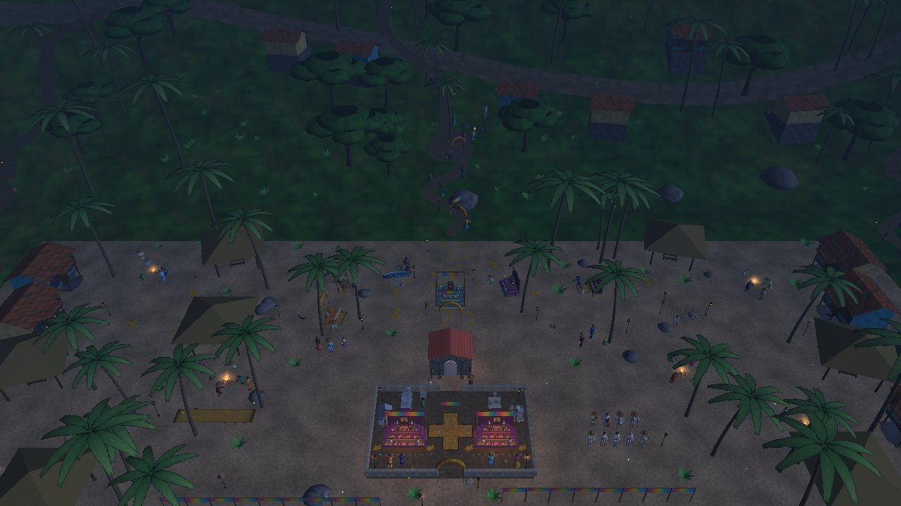

# Resumen del documento

## Qué es este manual

Este es el **Manual técnico** del proyecto *Recorrido virtual: Día de Muertos en Mazunte, Oaxaca*, desarrollado por **Nierika Studio** (Equipo 15; integrantes con números de cuenta 319266894 y 321332086) para la materia de Computación Gráfica e Interacción Humano-Computadora. Documenta cómo está construida la aplicación, por qué se tomaron las decisiones, cómo se gestionó el trabajo y qué se aprendió. El manual de usuario es un documento aparte.

El proyecto es un recorrido 3D en primera persona, en tiempo real, escrito en **C++17 con OpenGL 3.3 Core y GLSL 330** en Visual Studio 2022 (solo x64). El visitante camina del atardecer a la noche del 1 de noviembre por la playa de Mazunte, el panteón y un cuarto de cementerio con una ofrenda de tres niveles, abre fichas culturales con su fuente y puede seguir un recorrido narrado de 12 estaciones.

## El proyecto en cifras

Todas las cifras salen del repositorio (rama `develop` al 18/11/2026) o de mediciones del equipo; las que no son del repositorio lo dicen.

| Dato | Valor |
|---|---|
| Código C++ (`src/`) | 9 177 líneas en 44 archivos; shaders GLSL: 574 líneas |
| Modelos | 104 carpetas en `Models/` con 119 archivos `.obj` y 77 `.blend`; de ellos, 23 forman el inventario de «modelos propios» (meta ≥ 18, anexo A) |
| Animaciones | 10: 5 por KeyFrames y 5 simples (sección i) |
| Fichas culturales | 13, con referencias en APA 7 (secciones b y k) |
| Audio | 2 pistas ambientales y 12 narraciones del recorrido guiado |
| Recorrido guiado | 12 estaciones, tecla T, unos 6 min 30 s |
| Historial | 465 commits en `develop` entre el 19/10 y el 18/11 (464 con autor D2 y 1 de la plataforma Claude) y *pull requests* numerados hasta el #150 (consulta a la API de GitHub, 18/11; ver secciones d y e) |
| Rendimiento | En una laptop con Intel Core i5 de 11.ª generación y gráficos integrados: mínimo 45 FPS y promedio de unos 60, tras el PR #148 (antes, unos 15). En una GPU dedicada: entre 200 y 340 FPS. Mediciones de D2 en su equipo; el criterio del cliente es ≥ 30 FPS a 1280×720 |

## Dónde está cada elemento que pide la entrega

| Elemento de la rúbrica | Sección |
|---|---|
| a) Arquitectura del proyecto | a) Arquitectura |
| b) Investigación cultural que justifica la representación | b) Investigación cultural |
| c) Tecnologías utilizadas | c) Tecnologías |
| d) Cronograma final y comparación con la planeación inicial | d) Cronograma |
| e) Roles y responsabilidades (ejecución real) | e) Roles y RACI |
| f) Aplicación de la metodología de gestión, con evidencias | f) Metodología |
| g) Aprendizaje autónomo de herramientas nuevas, por integrante | g) Aprendizaje autónomo |
| h) Evidencias de herramientas colaborativas | h) Herramientas colaborativas |
| i) Animaciones complejas (una obligatoria con KeyFrames) | i) Animaciones |
| j) Redacción individual en inglés, por integrante | j) Redacción individual |
| k) Bibliografía final en APA 7 | k) Bibliografía |
| l) Conclusiones técnicas, sociales, económicas, ambientales y culturales | l) Conclusiones |
| m) Créditos y licencias de recursos externos | m) Créditos y licencias |

Los anexos reúnen el inventario de modelos y texturas, las pruebas y el rendimiento, y la justificación matemática completa de las animaciones.

## Cómo leer los datos de este manual

Este manual distingue lo que está **comprobado** (sale del código, de los documentos del repositorio o de una medición) de lo que es una **inferencia** o una **adaptación del estudio**, y lo dice en el texto. Cuando algo no se pudo verificar, se escribe que no se verificó en lugar de darlo por hecho. Dos reglas del proyecto lo sostienen: el registro de decisiones del archivo `docs/ESTADO_PROYECTO.md` manda sobre cualquier otro documento, y todo valor del manual debe coincidir con el código.

## Dos aclaraciones de alcance

1. **Elementos fuera del alcance original.** La propuesta aprobada dejó fuera las calles y edificios del pueblo, Punta Cometa y el tapete de arena. Durante la fase de refinamiento (del 12 al 18 de noviembre), D2 decidió agregar elementos que rebasan ese alcance: casas del fondo, un promontorio parecido a Punta Cometa, comparsa, banda de viento, ofrendas de familias, colinas caminables y más. Cada uno se registró en el ESTADO como «fuera del alcance original, por decisión de D2». D2 comentó que el profesor había permitido agregar extras si el equipo lo deseaba; **esa autorización no consta por escrito en el repositorio.**
2. **Animaciones.** La propuesta comprometió 5 animaciones (2 por KeyFrames y 3 simples). El documento de requerimientos del curso pide para la propuesta un mínimo de 2 de laboratorio y 5 de teoría, con al menos una por KeyFrames. El programa tiene hoy 10. La sección i) presenta la correspondencia y señala lo que queda por aclarar.
