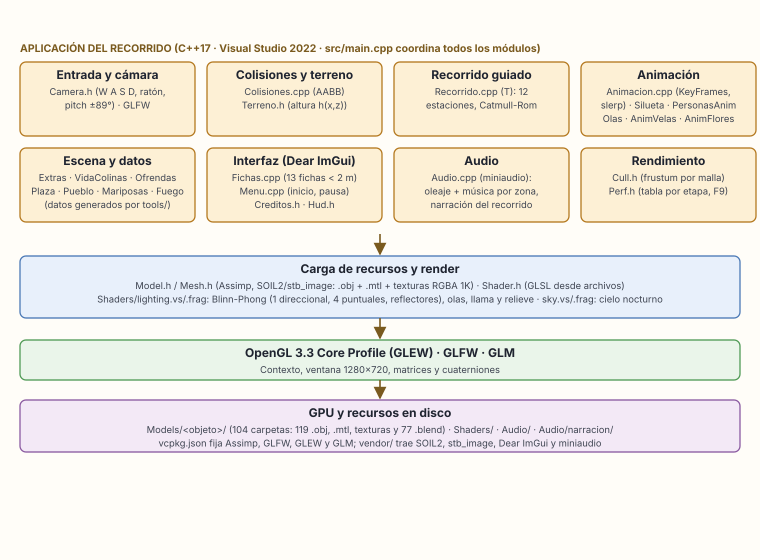
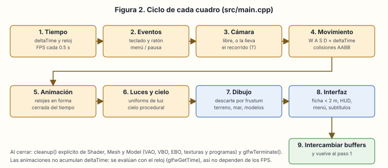

# a) Arquitectura del proyecto

## a.1 Visión general

La aplicación es un programa de escritorio en **C++17** que usa **OpenGL 3.3 Core Profile** (sin funciones heredadas) y shaders **GLSL 330**. Se organiza por capas, como se propuso en la propuesta v2.0: una capa de aplicación con los módulos propios del recorrido, una capa de carga de recursos y render, la API gráfica con sus bibliotecas de apoyo y, al fondo, la GPU y los archivos en disco. Todo movimiento se calcula en la aplicación (los KeyFrames están programados en C++); el oleaje se calcula en el *vertex shader* con la misma fórmula que en la CPU (`Olas.h`) para posar velas y flores sobre la ola.

## a.2 Módulos del código

El código vive en `src/` (9 177 líneas en 44 archivos) y los shaders en `Shaders/`. Se conserva el estilo de las clases del curso (`Shader`, `Camera`, `Model`, `Mesh`), que se ampliaron y no se reescribieron.

| Módulo (archivo) | Qué hace | Origen |
|---|---|---|
| `main.cpp` (≈ 2 450 líneas) | Ventana GLFW 1280×720, GLEW, carga de modelos y shaders, ciclo de render con `deltaTime`, entrada, menús, `cleanup()` | Práctica 6 del curso, ampliada |
| `Camera.h` | Cámara de primera persona: W A S D y flechas, ratón, pitch ±89°, 2.0 m/s | Clase del curso, ampliada |
| `Shader.h`, `Model.h`, `Mesh.h` | Compilar programas GLSL desde archivos; leer `.obj` con Assimp y texturas RGBA con SOIL2/stb_image; mapas de relieve; `Draw(Shader&)` y `cleanup()` | Clases del curso, ampliadas |
| `Colisiones.h/.cpp` | Colisiones AABB del cuerpo del visitante (0.5 × 0.5 × 1.7 m) contra cajas, deslizamiento por eje y altura del suelo | Propio |
| `Terreno.h` | Función de altura única h(x, z) que une la playa con las colinas, para poder caminarlas | Propio |
| `Animacion.h/.cpp` | `KeyFrame`, `Pista`, `Slerp` propio y curvas de aceleración (smoothstep) | Propio |
| `Silueta.h/.cpp`, `DejarFlor.h` | Silueta jerárquica de 10 piezas, caminata de 18.33 s y flor en Bézier | Propio |
| `PersonasAnim.h/.cpp` | Baile familiar, juego con el perro y sahumerio (KeyFrames); banda al compás y anfitriona (simples) | Propio |
| `Olas.h`, `AnimVelas.h`, `AnimFlores.h`, `Extras.h` | Fórmulas de las animaciones simples y de los extras ambientales (solo `<cmath>`) | Propio |
| `Recorrido.h/.cpp` | Recorrido guiado (tecla T): ruta Catmull-Rom con smoothstep por 12 estaciones | Propio |
| `Fichas.h/.cpp`, `Menu.h/.cpp`, `Hud.h`, `Creditos.h` | Dear ImGui: 13 fichas por proximidad (< 2 m), menú de inicio y pausa, avisos y créditos | Propio |
| `Audio.h/.cpp` | miniaudio: oleaje y música en bucle con volumen y paneo según la posición, y narración | Propio |
| `Cull.h`, `Perf.h` | Descarte por frustum por malla (sin cambio visual) y tabla de tiempos por etapa (tecla F9) | Propio |
| `VidaColinas`, `OfrendasFamiliares`, `PlazaTrasera`, `OfrendaMayor`, `PuebloFondo`, `DecoracionCasas`, `LucesCasas`, `Mariposas`, `Fuego`, `Atuendos`, `VegetacionColinas` | Posiciones y fórmulas de la escena; varios archivos de datos los **generan** los scripts de `tools/` (no se editan a mano) | Propio |
| `Shaders/lighting.vs/.frag` | Blinn-Phong con luz de luna direccional, luces de fogatas y faroles, reflectores y las 4 luces puntuales heredadas de D1 (apagadas, con color 0, desde X-60; ya no se animan); oleaje, llama con ruido de Perlin, relieve y descarte por alfa < 0.1 | Luces de D1 (Práctica 8) integradas; resto propio |
| `Shaders/sky.vs/.frag` | Cielo nocturno procedural: degradado, estrellas y luna | Propio |

## a.3 Ciclo de render

Resumen: en la inicialización se crean la ventana, GLEW, ImGui, los shaders, los modelos, las cajas de colisión y el audio. Cada cuadro calcula `deltaTime`, atiende la entrada (con colisiones), actualiza la cámara (libre o la que lleva el recorrido guiado), dibuja el cielo y las mallas visibles, y por último la interfaz. Las animaciones se evalúan con el reloj del programa en forma cerrada (no acumulan `deltaTime`), de modo que no dependen de los FPS. Al cerrar, `cleanup()` libera explícitamente VAO, VBO, EBO, texturas y programas de `Shader`, `Mesh` y `Model` antes de `glfwTerminate()`.

## a.4 Parámetros de cámara y proyección

Ventana de 1280×720 (no redimensionable), proyección con campo de visión de 45° y planos cercano y lejano de 0.1 y 300 m, ojos a 1.6 m de altura sobre el suelo, velocidad de 2.0 m/s y sensibilidad del ratón 0.25. Una unidad equivale a un metro.

## a.5 Organización del repositorio

| Ruta | Contenido |
|---|---|
| `src/` | Código C++ |
| `vendor/` | SOIL2 + stb_image, Dear ImGui y miniaudio, en código fuente (se compilan con el proyecto) |
| `Models/<objeto>/` | `.obj`, `.mtl`, texturas (en la misma carpeta) y, cuando existe, el `.blend` fuente |
| `Shaders/`, `Audio/` | GLSL 330; pistas ambientales y narración |
| `tools/` | Scripts de Python (`bpy`, numpy, Pillow) que generan modelos, texturas y datos, y programas de prueba numérica en C++; script de empaquetado |
| `docs/` | Estado del proyecto, contexto, plan, flujo de trabajo, propuesta (PDF), manuales, referencias, fichas y entrega |
| `vcpkg.json` | Assimp, GLFW, GLEW y GLM con versiones fijas por `builtin-baseline` |

## a.6 Decisiones de arquitectura

| Fecha | Decisión | Por qué |
|---|---|---|
| 18/10 | GLEW en lugar de GLAD; SOIL2 además de stb_image | La base de la Práctica 6 ya compilaba con ellos |
| 19/10 | Solución a x64 con vcpkg y `builtin-baseline` | La solución recibida estaba compilada en 32 bits; así todas las PC usan las mismas versiones |
| 19/10 | `cleanup()` explícito en lugar de destructores | Las clases `Shader`, `Mesh` y `Model` se copian (`vector<Mesh>`), y un destructor liberaría recursos aún en uso |
| 19/10 | `Draw(Shader&)` por referencia | Evitar copias del shader |
| 20/10 | Playa y mar en coordenadas del mundo, con matriz identidad | Simplifica colisiones y fórmulas |
| 04/11 | Iluminación Blinn-Phong con las luces de D1 | Decisión de D2; sustituye el plan inicial de luz ambiental más tres luces clave |
| 04/11 | Módulo de KeyFrames propio (`Animacion`) con slerp implementado a mano | Cumplir la exigencia de animaciones no copiadas del curso |
| 18/11 | Descarte por frustum y cachés de uniforms (X-68) | Pasar de unos 15 a 45 FPS o más en gráficos integrados sin cambiar lo que se ve |

El registro completo de decisiones, con fecha y motivo, está en `docs/ESTADO_PROYECTO.md`, sección 4.

## a.7 Rendimiento: cómo se resolvió el cuello de botella

Al medir en una laptop con gráficos integrados Intel (Core i5 de 11.ª generación), el programa iba a unos 15 FPS. El diagnóstico (18/11) contó unas 3 700 llamadas de dibujo y 1.27 millones de triángulos por cuadro, además de 17 luces evaluadas por fragmento. Los cambios de X-68 **no alteran la imagen**: descarte por frustum por malla con esfera envolvente (`Cull.h`), caché de ubicaciones de uniforms y de texturas enlazadas, salida anticipada de los reflectores fuera de su cono, ruido de borde arena/pasto solo en su franja y omisión de luces puntuales cuyo aporte máximo es menor que 0.0002. En una prueba con renderizador por software, la imagen resultó **idéntica píxel a píxel** a la anterior con el descarte y las cachés, y las llamadas de dibujo bajaron de 3 694 a 1 139 y los triángulos de 1.27 a 0.57 millones. Con estos cambios D2 midió en la laptop integrada un mínimo de 45 FPS y un promedio de unos 60. La tecla F9 imprime en consola una tabla de tiempos por etapa (CPU y GPU) para medir de nuevo.
