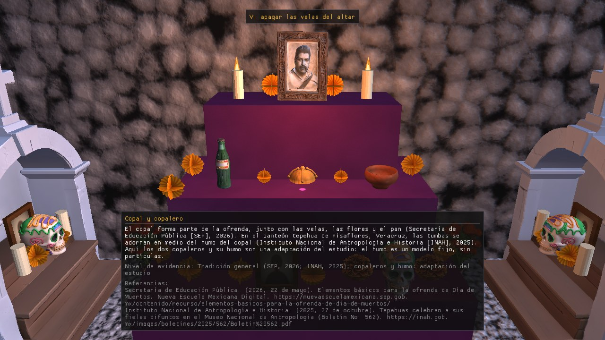
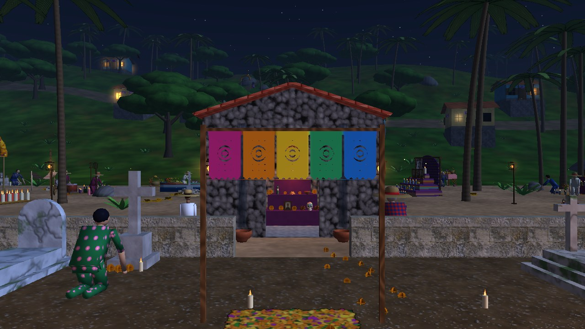

# b) Investigación cultural que justifica la representación

## b.1 Qué se representa y por qué

El proyecto representa el **atardecer y la noche del 1 de noviembre en Mazunte, Oaxaca**, en la costa del Pacífico. Se eligió la costa y no solo el altar doméstico porque en Mazunte la celebración tiene una forma propia: según Baños (2025), al atardecer se lanzan flores y velas al mar para recordar a quienes ya no están. De ahí salen las tres zonas del escenario: la **playa y la orilla**, donde se ofrenda al mar; el **panteón** con su barda, tumbas y papel picado; y el **cuarto del cementerio**, con una ofrenda de tres niveles. La investigación define qué elementos aparecen y qué significa cada uno; todo lo que el estudio **adaptó o inventó** se declara como adaptación en las fichas.

## b.2 Elementos de la ofrenda y su significado

Las fichas culturales se redactaron con las fuentes de la tabla siguiente y se compararon con ellas el 12/11/2026 (se corrigieron dos afirmaciones que las fuentes no respaldaban: el «color» del cempasúchil y la «velación» como acto central, según `docs/fichas_culturales.md`, sección 6).

| Elemento en la escena | Qué significa según la fuente | Fuente principal |
|---|---|---|
| Velas | Su flama guía a los muertos de regreso a casa | Secretaría de Educación Pública (SEP, 2026) |
| Flor de cempasúchil | Su aroma guía a las almas hacia el altar; en Mazunte se lanza al mar con las velas | SEP (2026); Baños (2025) |
| Papel picado | Da color y representa el aire en la ofrenda | SEP (2026) |
| Altar de tres niveles | Sobre él se colocan los elementos básicos (velas, flores, pan, agua y sal, copal); es una **adaptación del estudio** de la forma del altar | SEP (2026); UNESCO (s. f.) |
| Pan de muerto | Representa afecto y fraternidad hacia los difuntos | SEP (2026) |
| Copal y copalero | El copal forma parte de los elementos de la ofrenda; el humo no se simula con partículas porque el cliente lo dejó fuera de alcance | SEP (2026); INAH (2025) |
| Banda de viento | Tradición oaxaqueña que acompaña las fiestas comunales; la música elegida («Dios Nunca Muere») se declara como elección del estudio | México Desconocido (2023) |
| Panteón y tumbas | Los panteones se velan y se adornan en la noche del 1 y 2 de noviembre; las cuatro tumbas son una representación del estudio | México Desconocido (2026); UNESCO (s. f.) |
| Comparsa y camino de las ánimas | La comparsa y las alumbradas con velas y faroles son prácticas de Oaxaca; la procesión del recorrido es una adaptación del estudio | La Razón Online (2025); México Desconocido (2026) |
| Mariposa monarca | Se cree que son las almas que regresan; la creencia es de Michoacán, y aquí se usa como símbolo | Expansión Digital (2025) |
| Tortugas de Mazunte | Contexto local: Mazunte fue centro de caza de tortugas y hoy es santuario | México Desconocido (2010) |
| Ofrendas de las familias | Cada familia prepara su ofrenda; las 14 estructuras son distintas a propósito y son una adaptación del estudio | SEP (2026); UNESCO (s. f.); Baños (2025) |

Los niveles de evidencia que usan las fichas son tres: **tradición general**, **local documentado** y **adaptación del estudio**.

## b.3 Investigación sobre Mazunte (lados de la escena)

El 13/11/2026 se investigó el entorno de Mazunte para llenar los lados de la playa (`docs/investigacion_mazunte.md`). Lo que se encontró, y su respaldo:

| Tema | Hallazgo | Respaldo |
|---|---|---|
| Playa y paisaje | Playa de poco más de 1 km flanqueada por promontorios | México Desconocido (2017) y resúmenes de guías de viaje (estas últimas sin cita) |
| Pesca y lanchas | Hay pescadores y paseos en lancha | México Desconocido (2017) |
| Tortugas | Santuario y centro de estudio; anidan golfina, prieta y laúd; las fechas de creación del centro difieren entre fuentes (1991 y 1994) | México Desconocido (2010) |
| Vegetación | Selva baja caducifolia en la costa de Oaxaca | Fuentes oficiales de Oaxaca (el documento de 2019 no se pudo reabrir el 18/11, por eso no se cita) |
| Palapas | Parte del paisaje turístico | Solo guías de viaje; sin fuente oficial |
| Aves (pelícanos, fragatas) | Fauna típica de la costa del Pacífico | **Sin fuente específica de Mazunte** |
| Pueblo Mágico | Mazunte fue declarado Pueblo Mágico el 28 de septiembre de 2015 | Secretaría de Turismo de Oaxaca (s. f.); Geo-Mexico (2015) |

Las referencias completas están en la sección k) y en `docs/REFERENCIAS.md`.

## b.4 Lo que es adaptación del estudio

Para no presentar como tradición lo que es una decisión de diseño, el estudio declara como **adaptación**: la forma del cuarto del cementerio y del altar de tres niveles, las cuatro tumbas del panteón, los músicos y la música de la banda, la coreografía del baile (la chilena) y del juego con el perro, la procesión del camino de las ánimas y la hospitalidad de la anfitriona. Para la chilena y la hospitalidad **no se encontró una fuente APA**; por eso aparecen como adaptación sin cita. Las aves y las palapas tampoco tienen fuente específica de Mazunte.

## b.5 Estado del arte y referentes

La propuesta v2.0 tomó como referentes de recorridos virtuales culturales el Museo Memoria y Tolerancia (museo digital), los recorridos virtuales del INAH, el proyecto «Día de Muertos» de Google Arts & Culture y «Contigo en la Distancia» de la Secretaría de Cultura. Estos cuatro sitios se citaron en la propuesta y **no se volvieron a abrir en la verificación del 18/11/2026**; se mencionan como referentes de la propuesta, no como fuentes de contenido de las fichas.

## b.6 Dónde ver el contenido completo

- Fichas: los textos y su verificación están en `docs/fichas_culturales.md`; las 13 fichas se ven dentro del programa a menos de 2 m del objeto y en la narración del recorrido guiado (`docs/RECORRIDO_GUIADO.md`, sección 7, 12 guiones).
- Bibliografía: sección k) y `docs/REFERENCIAS.md` (inventario de 68 referencias con el estado de verificación de cada una).
- La ofrenda de las familias y su guion: `docs/GUION_OFRENDA.md`.
