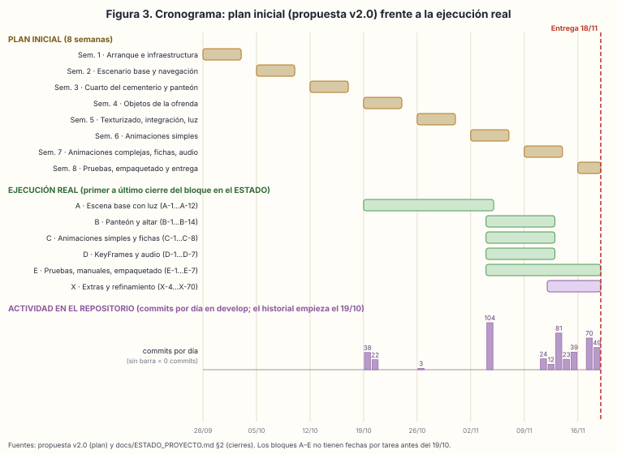

# d) Cronograma final y comparación con la planeación inicial

## d.1 Planeación inicial (propuesta v2.0, 4 de octubre de 2026)

La propuesta dividió el proyecto en **8 semanas** (28/09 a 18/11) y **60 actividades**, con un esfuerzo estimado de **203 horas** (173 de ejecución y 30 de verificación; 103.5 h para D1 y 99.5 h para D2), equivalentes a un costo de mano de obra de $16 217.16 MXN.

| Sem. | Fechas | Fase | Hito previsto |
|---|---|---|---|
| 1 | 28/09–02/10 | Arranque e infraestructura | Repositorio, proyecto base compilando, cuarto documentado |
| 2 | 05/10–09/10 | Escenario base y navegación | Playa y mar navegables en primera persona |
| 3 | 12/10–16/10 | Cuarto del cementerio y panteón | Fachada, arco, interior y barda modelados y texturizados |
| 4 | 19/10–23/10 | Objetos de la ofrenda | Altar de 3 niveles y 7 objetos modelados |
| 5 | 26/10–30/10 | Texturizado, integración e iluminación | Escena completa cargada, texturizada e iluminada |
| 6 | 02/11–06/11 | Animaciones simples | Olas, velas y flores integradas |
| 7 | 09/11–13/11 | Animaciones complejas, interacción y audio | 2 animaciones por KeyFrames, fichas y audio |
| 8 | 16/11–18/11 | Pruebas, empaquetado y entrega | Ejecutable, videos y manuales entregados |

## d.2 Replaneación del 18/10

El 18/10 el plan se reorganizó en **cinco bloques con códigos de tarea** (A-1, B-3, X-55…) que se usan en Trello, en el nombre de cada rama, en el *pull request* y en el ESTADO: **A** (19–25/10) escena base con luz; **B** (26/10–1/11) panteón y altar con ofrenda; **C** (2–8/11) animaciones simples y fichas; **D** (9–15/11) animaciones por KeyFrames y audio; **E** (16–18/11) entrega. También se acordó trabajar por disponibilidad: quien está libre toma la siguiente tarea y el otro integrante revisa (decisión del 18/10). El 04/11 se registró además que el trabajo seguía un **«pipeline vertical mínimo»**: primero un recorrido funcional de punta a punta (cámara, escalas, colisiones, playa, luz básica y un modelo por zona) y después las demás piezas, por lo que hay tareas de bloques tardíos terminadas antes que otras de bloques anteriores.

## d.3 Cronograma final

Fechas de cierre por tarea, tomadas del ESTADO (`docs/ESTADO_PROYECTO.md`, sección 2):

| Bloque | Tareas | Fechas de cierre registradas | Entregó |
|---|---|---|---|
| A · Escena base | A-1 a A-12 | 19/10 (A-1), 20/10 (A-2 a A-6), 25/10 (A-7), 03–04/11 (A-8 a A-12) | Escalas reales, ventana 1280×720, playa 100×50 m, mar, iluminación Blinn-Phong, colisiones, arco con dovelas, piso, techo y piedra |
| B · Panteón y altar | B-1 a B-14 | 04/11 (B-9, B-10) y 12/11 (el resto, tras verlas compiladas D2) | Altar, vela, cempasúchil, pan, botella, marco, papel picado, soportes, 4 tumbas, barda, roca, cruz, copalero y texturas propias |
| C · Animaciones simples y fichas | C-1 a C-8 | 04/11 y 12/11 | Olas, velas y flores flotando, llama con ruido, descarte por alfa, 5 fichas, justificación matemática |
| D · KeyFrames y audio | D-1 a D-7 | 04/11 (módulo de KeyFrames, caminata) y 12/11 | Silueta jerárquica, caminata con slerp, flor con Bézier, audio, justificación |
| E · Entrega | E-1 a E-7 | `cleanup()` y FPS (04/11), barda y colisiones (12/11), manuales (12/11 y 18/11), empaquetado en revisión | Contador de FPS, `cleanup()`, script de empaquetado, manuales |
| X · Extras y refinamiento | X-1 a X-70 | Del 04/11 al 18/11 (la mayoría, del 12 al 18/11) | Cielo nocturno, vegetación, colinas, banda, ofrendas de familias, comparsa, fichas 6 a 13, 5 animaciones nuevas, recorrido guiado, menú, rendimiento |

## d.4 Diferencias respecto del plan

| Aspecto | Plan | Real | Diferencia |
|---|---|---|---|
| Orden de ejecución | Secuencial por semanas | «Pipeline vertical mínimo» desde el 18/10 | Se terminaron antes tareas de bloques tardíos (por ejemplo, el módulo de KeyFrames el 04/11, cinco días antes de la semana prevista) |
| Bloque B (panteón y altar) | 26/10–01/11 | Cierres del 04/11 y del 12/11 | De **3 a 11 días** de retraso respecto del fin de la semana prevista (01/11) |
| Bloque C (simples y fichas) | 02/11–08/11 | Cierres del 04/11 al 12/11 | Hasta 4 días de retraso; las animaciones simples quedaron integradas el 12/11 |
| Bloque D (KeyFrames y audio) | 09/11–15/11 | Cierres del 04/11 al 12/11 | En tiempo, y parte adelantada |
| Bloque E (entrega) | 16/11–18/11 | Manuales, videos, empaquetado y refinamiento hasta el 18/11 | El cierre de entrega se concentró en los últimos días |
| Alcance | 5 animaciones, 5 fichas, 23 modelos | 10 animaciones, 13 fichas y más de 100 carpetas de modelos | Se amplió por decisión de D2 entre el 12 y el 18/11 (tareas X-18 a X-70) |
| Horas | 203 h estimadas | **No se registraron horas reales** | No se puede calcular la desviación en horas |

## d.5 Retrasos y causas

Las causas se separan en **documentadas** (están escritas en el ESTADO o en las auditorías del proyecto) e **inferidas** (deducidas por quien redacta este manual).

**Documentadas**

1. **La base heredada tenía que corregirse antes de avanzar.** La solución recibida estaba compilada en 32 bits y con escalas fuera de 1 u = 1 m (decisiones del 19/10 y A-2); esas correcciones se hicieron el 19 y el 20/10, dentro del bloque A.
2. **Un solo integrante activo en el repositorio.** La auditoría del 19/10 registró que los 27 commits de `develop` eran de D2, que D1 aún no había aceptado la invitación al repositorio y que el plan vigente no se cumple con un solo integrante activo. Al 18/11, 464 de los 465 commits de `develop` tienen a D2 como autor y el restante lo hizo la plataforma Claude (ver la sección e).
3. **Dos semanas casi sin actividad en el repositorio.** El historial de `develop` (465 commits, desde el 19/10) tiene 60 commits el 19 y el 20/10, solo 3 el 26/10 y **ninguno entre el 21/10 y el 03/11 salvo esos 3**; el 04/11 se registraron 104 de golpe y desde el 11/11 hubo actividad casi diaria. La causa de esa pausa no está escrita en el ESTADO. (El historial se reescribió el 19/10 para que todos los commits fueran del integrante, decisión registrada en el ESTADO; por eso el repositorio no permite reconstruir el trabajo de las semanas 1 a 3 del plan, del 28/09 al 18/10.)
4. **Modelos de D1 y luces de D1 integrados tarde.** La iluminación de D1 y sus extras de Maya (X-3) se integraron el 04/11, por decisión de D2, y no en la semana prevista.
5. **Verificación insuficiente.** La regla del 20/10 pedía un veredicto `/verificar` antes de cada fusión, pero desde el 12/11 D2 autorizó fusionar varios grupos de *pull requests* sin ese veredicto (excepciones registradas en el ESTADO), de modo que la revisión independiente que pedía el proceso no se aplicó a esos cambios.
6. **Ampliación de alcance.** Del 12 al 18/11 se agregaron 5 animaciones, 8 fichas, el recorrido guiado, menús, banda, comparsa, ofrendas y las colinas, tareas que no estaban en el plan y ocuparon el tiempo de la semana 8.

**Inferidas**

- El retraso del bloque B coincide con la concentración de cierres entre el 04/11 y el 12/11; es razonable deducir que la ejecución real comenzó tarde y se compensó con un ritmo intenso al final, pero el repositorio no registra horas por día que lo pruebe.
- Las medidas de rendimiento en gráficos integrados llegaron tarde (18/11), porque hasta entonces el equipo no había medido en ese tipo de equipo; el programa iba a unos 15 FPS y hubo que optimizar el último día.

## d.6 Horas reales y costo

La propuesta estimó 203 horas y un costo total de $23 409.50 MXN (precio al cliente de $31 228.27 MXN con utilidad e IVA). El equipo **no llevó un registro de horas reales** (el ESTADO y Trello no las guardan), de modo que este manual no inventa una cifra: la comparación se hace en fechas de cierre y en alcance, no en horas.
