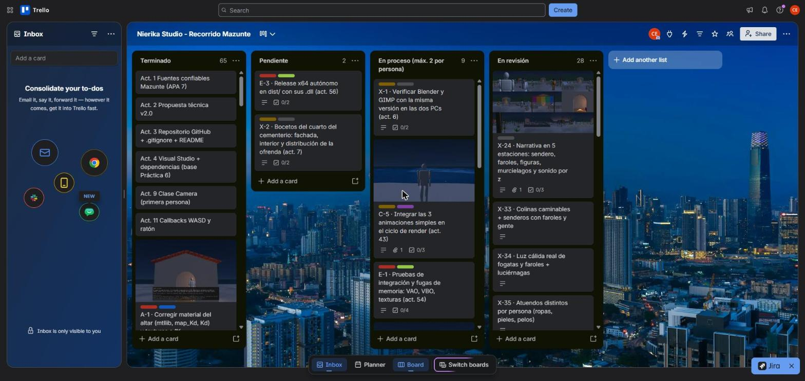

# f) Aplicación de la metodología de gestión

## f.1 Metodología elegida y por qué

La propuesta v2.0 comparó **Kanban, Scrum y Cascada** frente a las condiciones del proyecto (dos integrantes, ocho semanas, entregas semanales) y eligió **Kanban**, porque no exige roles formales ni reuniones largas (una reunión de unos 30 minutos por semana), muestra el flujo de trabajo en un tablero y, con un límite de trabajo en proceso, evita que se abran demasiadas tareas a la vez. Su desventaja, no fijar fechas, se compensó con los ocho hitos semanales del cronograma y con el límite de **dos tarjetas en proceso por integrante**.

## f.2 Cómo se aplicó

| Práctica de Kanban | Cómo se hizo en el proyecto |
|---|---|
| Tablero visual | Tablero de Trello «Nierika Studio - Recorrido Mazunte» con las columnas **Pendiente**, **En proceso** (máx. 2 por persona), **En revisión** y **Terminado** |
| Una tarjeta por tarea | Cada tarea tiene un código (A-1 a E-7 y X-1 a X-70) que se repite en la tarjeta, en la rama `feature/<código>-<nombre>`, en el título del *pull request* y en el ESTADO |
| Flujo hacia «Terminado» | Una tarea pasa a «En revisión» cuando existe su *pull request* y a «Terminado» al cumplir su criterio de terminado, escrito en el ESTADO |
| Revisión por el otro integrante | Regla del 18/10: el otro integrante revisa antes de integrar a `develop`. Desde el 20/10, comando `/verificar <código>` con veredicto APROBAR antes de cada fusión |
| Memoria única del proceso | `docs/ESTADO_PROYECTO.md` registra plan, estado de cada tarea, decisiones con fecha y motivo, parámetros con valores y problemas abiertos; se actualiza con `/cierre` al terminar cada sesión |
| Mejora continua | Replaneación del 18/10, auditorías del 19/10 y del 17/11 y 18/11, y decisiones registradas cuando algo no funcionaba (por ejemplo, el «pipeline vertical mínimo» del 04/11) |
| Control de versiones | Ramas `main` (solo entregas), `develop` (integración) y `feature/*`; todo entra por *pull request*; 491 commits en `develop` y PR numerados hasta el #159 |

*Captura del tablero del 17/11/2026, tomada desde la sesión de Trello de D2 en su navegador (el entorno en la nube no puede abrir Trello).*

## f.3 Resultado de la aplicación: lo que funcionó y lo que no

**Funcionó**

- El código de tarea ligó cada cambio de Trello, rama, PR y ESTADO; el historial permite rastrear cualquier cambio hasta su tarea y su decisión.
- El registro de decisiones evitó discutir dos veces lo mismo y detectó contradicciones (por ejemplo, los 6 s de la caminata frente a la distancia real, resueltos el 04/11 con 18.33 s).
- Las tareas A-1, A-2, A-5 a A-8, X-3, B-9 y B-10 tienen registrado un veredicto `/verificar` APROBAR antes de su fusión (ESTADO, sección 2).

**No funcionó como se planeó**

- El tablero de la captura muestra **9 tarjetas en «En proceso»**, más de lo que permite el límite de dos por integrante, y las tarjetas no tienen miembros asignados (según la auditoría del 19/10, el único miembro del tablero era D2). Es decir, el límite de trabajo en proceso se declaró pero no se hizo cumplir.
- La captura semanal del Trello y la minuta de los viernes, acordadas el 19/10 como evidencia de gestión, **no se guardaron de forma continua**: solo hay una captura tomada durante el desarrollo (17/11). Las capturas del 18/11 y los diagramas de Gantt de la sección f.4 se elaboraron al cierre, como evidencia, a partir del tablero y de los datos del proyecto.
- Desde el 12/11 se fusionaron varios grupos de *pull requests* sin el veredicto `/verificar` por decisión de D2 (excepciones registradas en el ESTADO), por lo que el control de calidad de esos cambios no tuvo revisión independiente.
- La revisión «por el otro integrante» no ocurrió en la práctica (ver la sección e).
