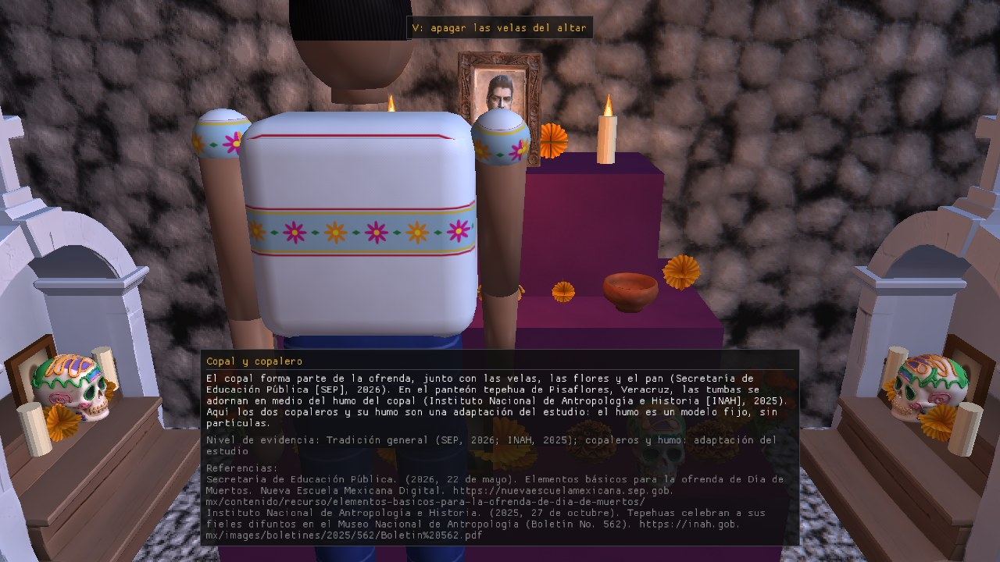

# i) Animaciones complejas implementadas

## i.1 Qué se pide y qué hay

El documento de requerimientos del curso pide, para la propuesta, **al menos 2 animaciones de laboratorio y 5 de teoría, y al menos una con KeyFrames**; para la entrega, animaciones completas y funcionales, relacionadas con la celebración, **ninguna copiada de las prácticas del curso**, con una animación compleja obligatoria por KeyFrames. La propuesta v2.0 aprobada comprometió **5 animaciones: 2 por KeyFrames y 3 simples**. El programa tiene hoy **10**: las 5 comprometidas y 5 agregadas el 17/11 por decisión de D2 (3 por KeyFrames y 2 simples).

| N.º | Animación | Tipo | Técnica | En la propuesta aprobada | Función en la experiencia |
|---|---|---|---|---|---|
| 1 | Caminata de la silueta (orilla → altar) | **KeyFrames** | Cuaterniones con slerp propio, smoothstep, jerarquía de 10 piezas | Sí | Una figura recorre el camino de las ánimas hasta el altar |
| 2 | La silueta deja una flor | **KeyFrames** | Brazo por KeyFrames y flor en curva de Bézier cuadrática (caída libre) | Sí | Cierra el recorrido: la ofrenda del visitante simbólico |
| 3 | Olas del mar | Simple | Suma de 3 senoidales en el *vertex shader*, normal analítica | Sí | Da vida a la orilla y mueve velas y flores |
| 4 | Velas flotando (y su llama) | Simple | Bézier mar adentro, vaivén senoidal con desfase; llama con ruido de Perlin | Sí | Recrea la ceremonia de velas al mar |
| 5 | Flores de cempasúchil flotando | Simple | Movimiento circular, giro con pausas y altura de la ola | Sí | Recrea las flores ofrendadas al mar |
| 6 | Baile familiar (la chilena) | **KeyFrames** | Pistas cíclicas de pasos, órbita de 12 KeyFrames y slerp | No (17/11) | Da vida a la playa junto a la música de la banda |
| 7 | Juego con el perro | **KeyFrames** | Pistas de lanzar, correr, recoger; tiro parabólico de la pelota | No (17/11) | Escena de convivencia en la playa |
| 8 | Sahumerio con copal | **KeyFrames** | Pistas de brazo y copalero por slerp | No (17/11) | Muestra el gesto de sahumar la ofrenda |
| 9 | Banda al compás | Simple | Senos al pulso de la música (90 BPM declarados) | No (17/11) | Los músicos se mueven con la música que se oye |
| 10 | Anfitriona | Simple | Senos más giro hacia el visitante | No (17/11) | Recibe al visitante en la orilla (interacción) |

## i.2 Correspondencia con el requisito «2 de laboratorio + 5 de teoría»

- **Cantidad:** el proyecto tiene 10 animaciones, más que las 7 que suman 2 + 5, y **5 de ellas son por KeyFrames** (la obligatoria está cubierta con la caminata de la silueta, la flor y las tres de personas).
- **Qué no se puede afirmar con los documentos del repositorio:** el documento de requerimientos **no define qué cuenta como animación «de laboratorio» y cuál «de teoría»**, y la propuesta aprobada no usa esa clasificación (habla de 5 animaciones: 2 complejas y 3 simples). Por eso este manual **no asigna** cada animación a una u otra categoría por su cuenta. Si el profesor pide el reparto, una lectura razonable, **que debe confirmarse con él**, sería tomar las 2 de KeyFrames de la propuesta como las complejas y el resto como las simples.
- **Qué está aprobado:** solo las 5 primeras forman parte de la propuesta aprobada; las animaciones 6 a 10 son un agregado del 17/11 y no pasaron por esa aprobación.

## i.3 Justificación matemática (resumen)

Todas las animaciones se evalúan **en forma cerrada del tiempo** (no acumulan `deltaTime`), de modo que no dependen de los FPS. Las derivaciones completas, con cada término y el valor del código, están en los anexos C, D y E; aquí van las fórmulas de las dos animaciones complejas comprometidas.

**Interpolación de rotaciones (slerp).** Entre dos cuaterniones unitarios $a$ y $b$ con $\cos\theta = a\cdot b$:

$$\operatorname{slerp}(a,b,s)=\frac{\sin((1-s)\theta)\,a+\sin(s\theta)\,b}{\sin\theta}$$

Gira con velocidad angular constante sobre el camino más corto (si $a\cdot b<0$ se invierte $b$). Se prefiere a los ángulos de Euler porque evita el bloqueo de cardán y da giros uniformes en cada articulación.

**Curva de aceleración (smoothstep).** Para que la silueta arranque y frene sin tirones se usa $S(\tau)=3\tau^{2}-2\tau^{3}$, el polinomio cúbico más simple con $S(0)=0$, $S(1)=1$ y $S'(0)=S'(1)=0$. En la caminata, las dos rampas de 2 s (`SmoothIn` y `SmoothOut`) recorren 1.867 m cada una; con crucero de 1.4 m/s el camino de 23.8 m (de $z=+24$ a $z=+0.2$) dura **18.33 s** en total (2 s + 14.33 s + 2 s). La propuesta decía 6 s: la distancia real lo hace imposible (≈ 4 m/s), y la decisión del 04/11 del ESTADO fijó 18.33 s.

**Jerarquía de la silueta.** Cada pieza tiene su pivote en la articulación y su matriz es $M_{hijo}=M_{padre}\,T(\mathbf{o})\,R(\mathbf{q})$ con $\mathbf{o}$ el desplazamiento de la articulación; así brazos y piernas siguen al torso. Las piernas van desfasadas medio ciclo (zancada de 1 s) y los brazos en oposición.

**Flor que cae (Bézier cuadrática).** Con $P_0$ en la mano, $P_1$ a la altura de la mano y a medio camino horizontal, y $P_2=(1.05,\,0.435,\,z_{mano})$ en la repisa:

$$B(\tau)=(1-\tau)^2P_0+2\tau(1-\tau)P_1+\tau^2P_2$$

La coordenada vertical queda $y(\tau)=y_0-h\tau^2$, es decir, **una caída libre** con $h\approx0.901$ m y duración $T_b=\sqrt{2h/g}\approx0.429$ s. La comprobación numérica dio un error de 2.4×10⁻⁷ m.

**Animaciones simples.** Olas: $y=-0.2+\sum_i A_i\sin(k_i\,\mathbf{d}_i\cdot\mathbf{p}-\omega_i t+\varphi_i)$ con $\omega_i=\sqrt{9.81\,k_i}$, tres ondas de amplitudes 0.040, 0.025 y 0.015 m y longitudes de onda 12, 7 y 4.5 m; la altura queda entre −0.28 y −0.12 m. Velas: Bézier cuadrática mar adentro más vaivén de 0.012 m con periodo de 2.4 s y desfase por vela; llama con ruido de Perlin de 3 octavas. Flores: círculo de 0.45 a 0.75 m, giro de 0.6 a 1.0 rad/s y altura igual a la de la ola más 0.02 m.

## i.4 Pruebas y límites

- Las comprobaciones numéricas se corren con programas aparte: 23 sobre la caminata y la flor (`tools/d7_pruebas_matematicas.cpp`) y 23 sobre las animaciones de personas (`tools/x55_pruebas.cpp`), con 0 fallos.
- Las animaciones se ven funcionando en el programa (Visual Studio 2022). Con todas activas, el mínimo medido en gráficos integrados fue de 45 FPS.
- **No se pudo verificar desde el repositorio** que ninguna animación coincida con las de las prácticas del curso, porque esas prácticas no forman parte del repositorio. Cada anexo explica en qué se diferencia la técnica y qué debe comparar el equipo.
