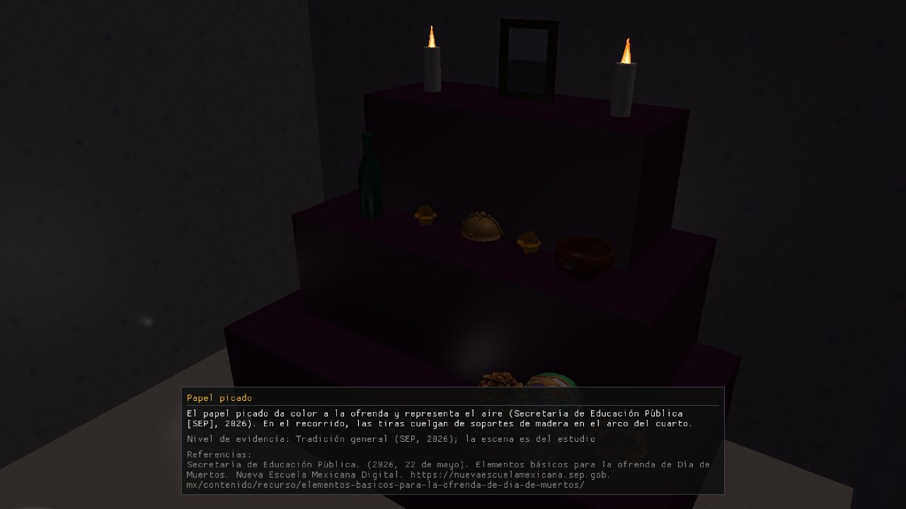
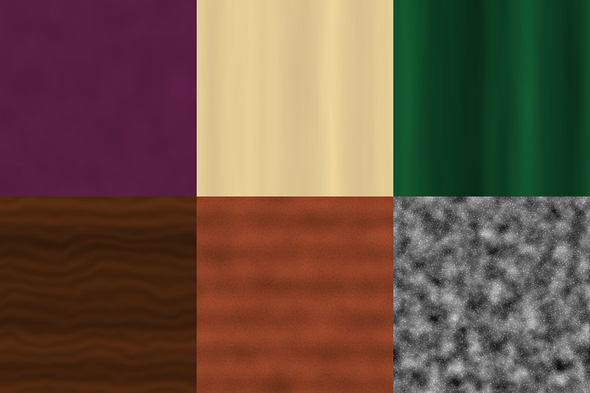

# Anexo A. Modelado y texturizado: inventario de modelos y texturas

## A.1 Definición de «modelo propio»

Cada objeto distinto modelado por el equipo **en Blender** y exportado a su propio `.obj` en `Models/<objeto>/`. Las copias o instancias cuentan una vez; las variantes con geometría distinta (cada tumba) cuentan por separado. Se guarda el archivo fuente `.blend` como evidencia. Los modelos externos solo son secundarios y con crédito (decisión del 19/10 en el ESTADO).

## A.2 Conteo al 18/11/2026

| Concepto | Valor |
|---|---|
| Meta del cliente | ≥ 18 modelos propios |
| Inventario del ESTADO | 23 modelos (18 si se excluyen las 5 mallas planas: piso, playa, mar, papel picado y cempasúchil) |
| Presentes en `develop` | **23 de 23** con `.obj` y `.blend` (tabla calculada de los archivos con `tools/e5_tabla_modelos.py`) |
| Total en el repositorio | 104 carpetas en `Models/` con 119 `.obj` y 77 `.blend`; el resto son extras, personas, construcciones y los modelos de Maya de D1 |

**Cómo se hicieron.** Los 23 modelos se modelaron en Blender; buena parte se **generó con scripts de Python (`bpy`) que están en `tools/`** y que D2 pidió con ayuda de un asistente de IA (Claude) y revisó; algunos los hizo D2 a mano en Blender (playa y mar). Los modelos de Maya de D1 (calavera, pan, flor, humo, fuego, mariposas y otros) no cuentan entre los 23 por la decisión «solo Blender». Lo que el repositorio **no prueba** es que cada `.blend` sea de autoría manual del equipo: el de la fachada se reconstruyó a partir del `.obj` al reexportarlo a escala real.

## A.3 Medidas reales de los 23 modelos del inventario

Calculadas el 18/11/2026 sobre `develop` con `python3 tools/e5_tabla_modelos.py`. Los triángulos cuentan una cara de *n* lados como *n − 2*. Las dimensiones de la silueta suman sus piezas con el pivote en el origen (la figura armada mide unos 1.7 m).

| # | Modelo | Triángulos | Vértices | Dimensiones x · y · z (m) | `.blend` | Texturas (px) |
|---|---|---|---|---|---|---|
| 1 | `fachada` | 140 | 68 | 3.93 · 3.28 · 2.62 | sí | `laminado1.jpg` 512×512, `piedra.jpg` 1024×1024 |
| 2 | `techo` | 64 | 34 | 4.18 · 0.70 · 3.43 | sí | `laminado1.jpg` 512×512 |
| 3 | `arco` | 108 | 72 | 1.57 · 0.77 · 0.08 | sí | `piedra.jpg` 1024×1024 |
| 4 | `piso` | 2 | 4 | 3.93 · 0.00 · 2.62 | sí | `piso_piedra.jpg` 1024×1024 |
| 5 | `playa` | 2500 | 1326 | 100.00 · 0.50 · 50.00 | sí | `arena.jpg` 1024×1024 |
| 6 | `mar` | 20000 | 10201 | 100.00 · 0.00 · 100.00 | sí | `mar_agua.png` 1024×1024 |
| 7 | `tumba1` | 310 | 169 | 1.30 · 1.90 · 0.90 | sí | `tumba1_piedra.png` 1024×1024 |
| 8 | `tumba2` | 80 | 46 | 1.00 · 1.05 · 2.00 | sí | `tumba2_piedra.png` 1024×1024 |
| 9 | `tumba3` | 60 | 40 | 1.10 · 1.16 · 2.00 | sí | `tumba3_piedra.png` 1024×1024 |
| 10 | `tumba4` | 32 | 22 | 1.20 · 0.90 · 1.70 | sí | `tumba4_piedra.png` 1024×1024 |
| 11 | `barda` | 72 | 48 | 14.00 · 0.70 · 9.00 | sí | `barda_arenisca.jpg` 1024×1024 |
| 12 | `roca` | 108 | 56 | 0.56 · 0.33 · 0.47 | sí | `piedra.jpg` 1024×1024 |
| 13 | `cruz` | 48 | 32 | 0.60 · 1.50 · 0.60 | sí | `cruz_piedra.png` 1024×1024 |
| 14 | `soportes` | 36 | 24 | 1.85 · 2.00 · 0.05 | sí | `soportes_madera.png` 1024×1024 |
| 15 | `papel_picado` | 680 | 385 | 1.70 · 0.50 · 0.00 | sí | `papel_picado.png` 1024×1024 |
| 16 | `altar3` | 36 | 24 | 1.60 · 1.20 · 0.90 | sí | `altar3_tela.png` 1024×1024 |
| 17 | `vela` | 60 | 32 | 0.06 · 0.15 · 0.06 | sí | `vela_cera.png` 1024×1024 |
| 18 | `cempasuchil` | 6 | 12 | 0.07 · 0.07 · 0.07 | sí | `cempasuchil.png` 1024×1024 |
| 19 | `pan_muerto` | 624 | 352 | 0.16 · 0.08 · 0.16 | sí | `pan_muerto.png` 1024×1024, `pan_muerto_relieve.png` 1024×1024 |
| 20 | `botella` | 672 | 338 | 0.08 · 0.30 · 0.08 | sí | `botella_vidrio.png` 1024×1024 |
| 21 | `marco` | 50 | 36 | 0.20 · 0.25 · 0.02 | sí | `foto_retrato.png` 1024×1024, `marco_madera.png` 1024×1024 |
| 22 | `silueta` | 3244 | 1666 | 0.36 · 1.03 · 0.25 | sí | `silueta_huarache.png` 1024×1024, `silueta_huipil.png` 1024×1024, `silueta_pantalon.png` 1024×1024, `silueta_pelo.png` 1024×1024, `silueta_piel.png` 1024×1024 |
| 23 | `copalero` | 432 | 218 | 0.17 · 0.09 · 0.17 | sí | `copalero_barro.png` 1024×1024 |

## A.4 Texturizado

Las texturas son de **1024 × 1024 píxeles** (1K), cargadas en RGBA (el fragment shader descarta los fragmentos con alfa menor que 0.1). La única excepción es `laminado1.jpg` (512 × 512), usada en la fachada y el techo. El pan de muerto lleva además un mapa de relieve que el shader convierte en normal sin tangentes.

| Textura | Uso | Origen | Crédito |
|---|---|---|---|
| `arena.jpg` | Playa | *Sandy Gravel*, Poly Haven, CC0 (Baglioni, 2023) | Sí |
| `piso_barro.jpg` | Piso del cuarto | *Clay Floor 001*, Poly Haven, CC0 (Savva y Cilliers, 2021) | Sí |
| `barda_arenisca.jpg` | Barda | *Large Sandstone Blocks 01*, Poly Haven, CC0 (Tuytel, 2020) | Sí |
| `piedra.jpg` | Muros, dovelas y roca | Procedural (Voronoi), generada por el equipo | Propia |
| `concreto.jpg` y `laminado1.jpg` | Arco, fachada, piso y techo | Creadas en Blender por el equipo (confirmado por D2 el 18/11/2026) | Propias |
| `mar_agua.png`, texturas de tumbas, cruz, soportes, silueta, palmas y arbustos | Mar y elementos del panteón y la vegetación | Generadas con `tools/x6_texturas.py`, `x9_vegetacion.py` y `x58_silueta_texturas.py` | Propias |
| `altar3_tela.png`, `vela_cera.png`, `botella_vidrio.png`, `marco_madera.png`, `copalero_barro.png`, `pan_muerto_relieve.png` | Ofrenda | Generadas con `tools/b12_texturas.py` (numpy, semilla fija) | Propias |
| `cempasuchil.png`, `papel_picado.png`, `pan_muerto.png` (RGBA) | Flor, papel picado y pan | Generadas con `tools/b3_*.py`, `b7_*.py` y `b4_*.py` | Propias |
| `texture_diffuse.png` y similares | Modelos de Maya de D1 | Hechas por el equipo en Maya (confirmado por D2 el 18/11/2026) | Propias |

La foto del marco (`foto_retrato.png`) es un retrato genérico sin rostro.
