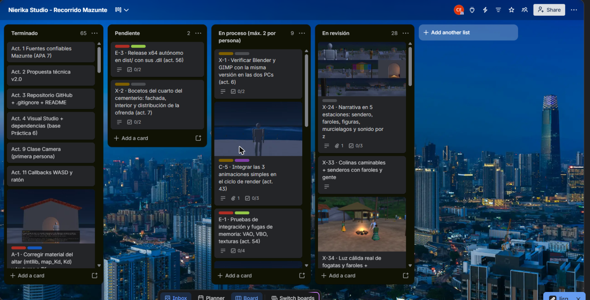
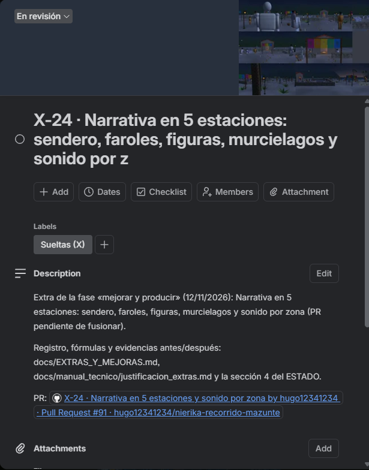
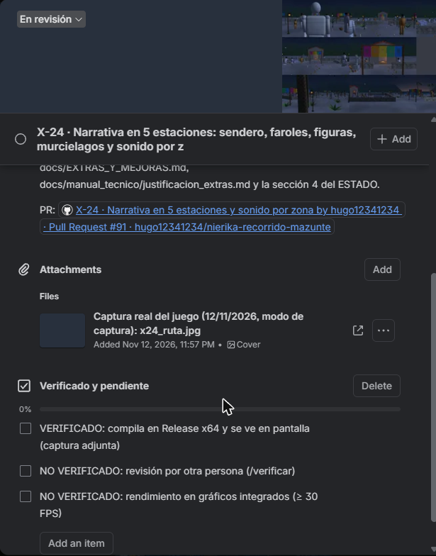
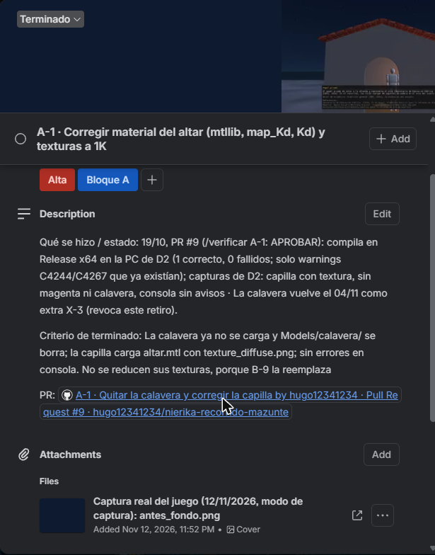
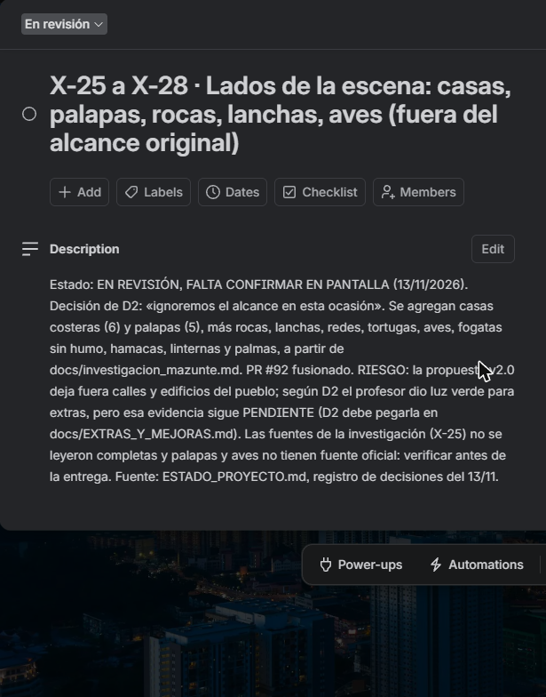
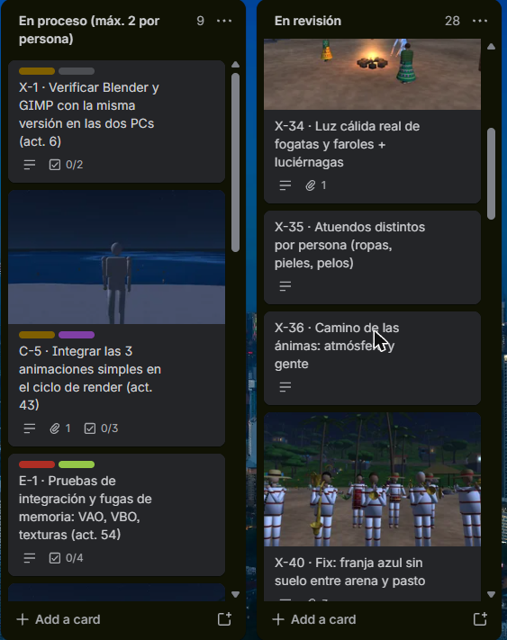
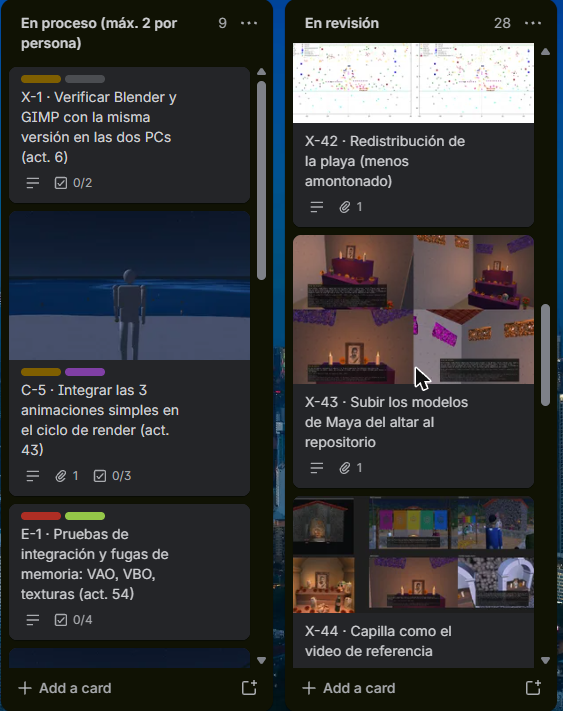
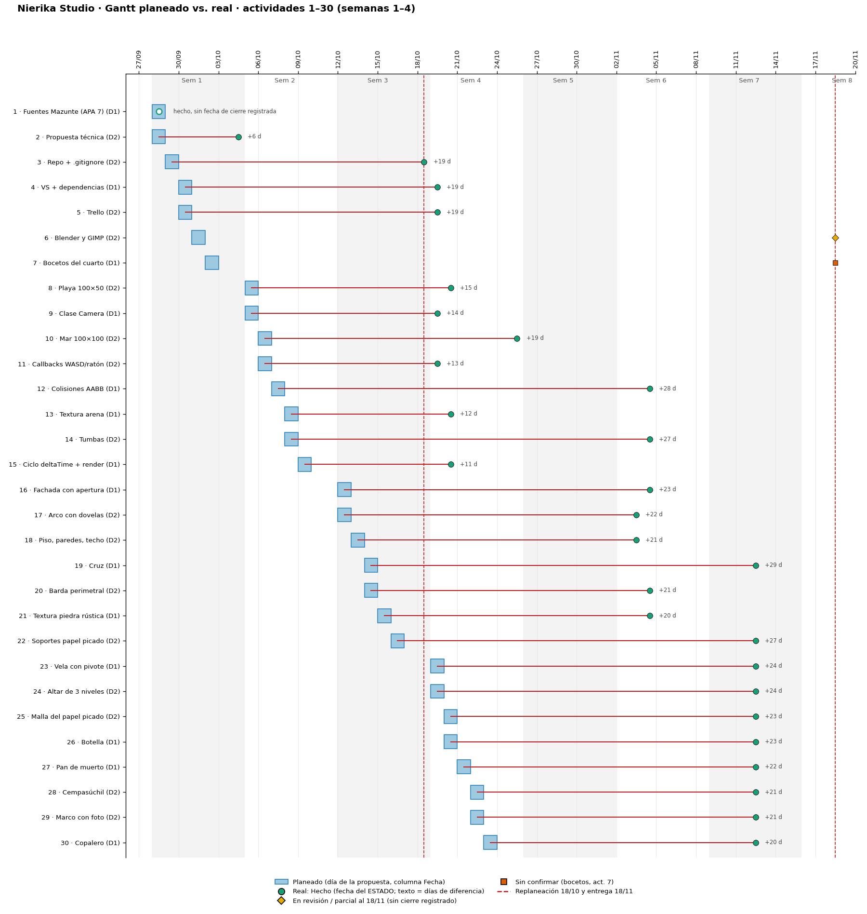
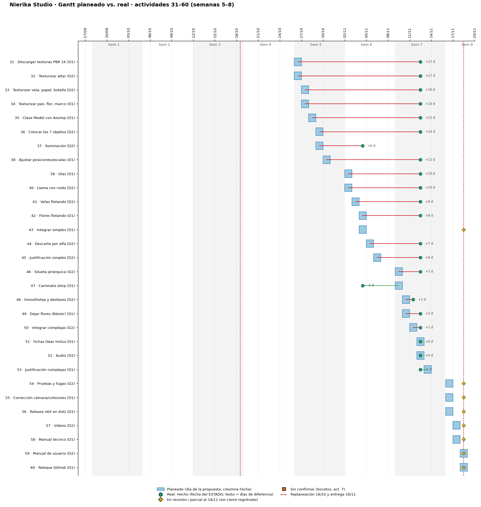

# Metodología de gestión y evidencias de herramientas colaborativas

> **Qué es este documento:** sección suelta del manual técnico de Nierika Studio (Equipo 15) que responde a dos
> puntos de la rúbrica: *«Aplicación de la metodología de gestión seleccionada, incluyendo evidencias de su uso»* y
> *«Evidencias del uso de herramientas colaborativas (capturas de Jira, Trello, diagramas de Gantt, etc.)»*.
> **Integrantes:** D1 = 319266894 · D2 = 321332086.
> **Fecha de las capturas:** 18/11/2026, ~01:10 h (hora de México), tomadas del tablero real de Trello.
>
> **Marcas de confianza:** ✅ **verificado** (visto en el tablero, en `git` o en un documento del repositorio) ·
> 🔍 **inferido** (conclusión nuestra a partir de lo verificado, sin registro directo) · ❓ **no hay evidencia**.

---

## 1. Metodología seleccionada: Kanban con bloques semanales

### 1.1 Qué se eligió y por qué ✅

La propuesta técnica y el `CONTEXTO_PROYECTO.md` (§6 y §7) fijan **Trello como tablero Kanban**. No usamos
Scrum: ✅ no hubo sprints formales, *daily*, *backlog* priorizado por un *Product Owner* ni *burndown*. Para un
equipo de dos personas con una fecha fija de entrega (18/11/2026), un flujo continuo de tarjetas con límite de
trabajo en curso era más simple que las ceremonias de Scrum.

Reglas acordadas (✅ `CONTEXTO_PROYECTO.md` §7, «Kanban»):

| Regla | Valor acordado |
|---|---|
| Columnas | Pendiente · En proceso · En revisión · Terminado |
| Límite de trabajo en curso (WIP) | **máx. 2 tarjetas en proceso por integrante** |
| Revisión | cada viernes, 30 min |
| Definición de terminado | el entregable está en `develop`, **compila sin errores** y el otro integrante lo aprobó en el PR |

Además de las columnas, el plan se organizó en **bloques semanales A–E** (replaneación del 18/10, ✅ ESTADO §2):
A = escena base (19–25 oct), B = panteón y altar (26 oct–1 nov), C = animaciones simples y fichas (2–8 nov),
D = animaciones por KeyFrames y audio (9–15 nov), E = entrega (16–18 nov). Cada bloque es una etiqueta de color
del tablero y cada tarea lleva un **código** (`A-1`…`E-7`; `X-n` para tareas sueltas).

### 1.2 Cómo se vio en la práctica (lectura honesta)

- ✅ El tablero tiene las cuatro columnas acordadas y el límite de WIP escrito en el nombre de la lista
  («En proceso (máx. 2 por persona)»), ver Figura 1.
- ✅ **El límite no se respetó al cierre:** el 18/11 había **9 tarjetas en «En proceso»**; con dos integrantes el
  máximo habría sido 4. Se debe a las tareas sueltas `X-n` del 12–17/11, que se acumularon al final.
- ✅ La columna «En revisión» llegó a **28 tarjetas** (de `X-24` a `X-56`, más `X-25 a X-28`), es decir,
  trabajo hecho que esperaba revisión del otro integrante o compilación en Windows (Figuras 6 y 7). Esto es un
  cuello de botella típico de Kanban que sí quedó a la vista en el tablero.
- ❓ **Revisión semanal de los viernes:** no hay minutas guardadas (`docs/manual_tecnico/evidencias/` no tiene
  ninguna `*_minuta.md`). No podemos probar que se hicieron todos los viernes.

---

## 2. Cómo se aplicó: herramientas y flujo de trabajo

El ciclo de cada tarea está en `FLUJO_DE_TRABAJO.md` y se resume así:

```
Tarjeta en Trello (código X-n / A-1…E-7) ──► rama feature/<código>-<nombre> desde develop
   ──► /actividad  (Claude Code lee el ESTADO y muestra el criterio de terminado)
   ──► trabajo + compilar (F5) ──► /cierre (actualiza docs/ESTADO_PROYECTO.md)
   ──► pull request hacia develop ──► /verificar (revisión contra el criterio) ──► otro integrante aprueba y fusiona
   ──► tarjeta a «Terminado»
```

| Herramienta | Uso | Evidencia | Confianza |
|---|---|---|---|
| **Trello** (Kanban) | Estado de cada tarea, etiquetas de bloque y prioridad, enlace al PR, capturas adjuntas | Figuras 1–7 | ✅ |
| **GitHub** (ramas + PR) | Una rama `feature/<código>` por tarea y todo entra a `develop` por PR | `git log`: **165 PR fusionados** a `develop` (19/10–18/11, API de GitHub, al corte de las 23:05 UTC del 18/11); 128 desde ramas `feature/…` y 37 desde ramas `claude/…` (hilos web) | ✅ |
| **Registro de decisiones** (`ESTADO_PROYECTO.md` §4) | Todo cambio de alcance, valor o regla se anota antes de tocar el código | Sección 4 del ESTADO (decisiones por fecha) | ✅ |
| **Comandos `/actividad`, `/cierre`, `/verificar`** y subagentes (`verificador`, `revisor-opengl`, `justificacion-matematica`) | Arrancar, cerrar y revisar tareas con el mismo formato | `.claude/skills/` y `.claude/agents/` en el repositorio | ✅ existen · 🔍 uso por tarea visible en las descripciones de las tarjetas |
| **Hoja del plan** (Excel/Google Sheets) | Las 60 actividades originales con fecha, responsable, horas y estado | `Plan_de_Proyecto_Mazunte_actualizado_2026-11-03.xlsx` (hoja «Plan de trabajo») | ✅ |
| **Claude (Claude Code y Proyecto web)** como asistente | Planeación, código, documentación y revisión; documentado en `CLAUDE.md`. Regla del equipo: los commits y PR van **solo a nombre del integrante**, sin marcas de Claude | `CLAUDE.md` §5; `git log` | ✅ |

### 2.1 Revisión cruzada: qué sí y qué no se puede afirmar

- ✅ La regla del equipo es que **nada entra a `develop` sin la revisión del otro integrante** y existen
  veredictos `/verificar … APROBAR` en los PR #9, #11, #13–#17, #40 y #41 (según el registro del ESTADO, estado al 12/11).
- ✅ Los 507 commits de `develop` (API de GitHub, al corte de las 23:05 UTC del 18/11): 505 a nombre de **D2** y 2 de la cuenta «Claude». El historial
  de Git **no muestra commits de D1**. El ESTADO registra que D1 fue invitado al repositorio y aún no había aceptado la
  invitación. Por eso la revisión cruzada **no puede demostrarse con el historial de GitHub** para la mayor parte del
  trabajo; ver la sección e) del manual.
- ✅ Desde el 12/11 las tareas B-12, B-13 y C-1…D-7 se cerraron con la nota «visto por D2 … sin `/verificar` de
  otra persona» (ESTADO §3). Es decir, **varias tareas se cerraron con visto bueno de una sola persona**; no se
  presentan como revisión independiente.
- 🔍 El uso de IA como asistente (Claude Code y Proyecto web) está documentado, pero el criterio y la decisión
  final de cada cambio quedan en el integrante, que es quien compila, ve la pantalla y hace el PR.

---

## 3. Evidencia: tablero de Trello (capturas reales del 18/11/2026)

Las capturas son del tablero **«Nierika Studio - Recorrido Mazunte»** (`https://trello.com/b/8FNkEY97`), tomadas con
el navegador de la cuenta de D2. No se modificó nada en el tablero. Para proteger datos personales solo se incluyen
recortes sin el panel de «Comentarios y actividad» (que muestra el nombre completo de la cuenta).

### Figura 1. Vista general del tablero con sus cuatro listas



*Figura 1. Tablero Kanban del 18/11/2026: **Terminado 65 · Pendiente 2 · En proceso (máx. 2 por persona) 9 ·
En revisión 28** (104 tarjetas). Se ven etiquetas de colores (prioridad y bloque), la tarjeta A-1 con su captura
de portada y los iconos de descripción, adjuntos y lista de verificación. ✅ verificado.*

### Figura 2. Tarjeta X-24: etiqueta, descripción y PR enlazado



*Figura 2. Tarjeta `X-24 · Narrativa en 5 estaciones` en «En revisión»: etiqueta **Sueltas (X)**, descripción con
el estado, los documentos donde quedó el registro (`EXTRAS_Y_MEJORAS.md`, `justificacion_extras.md`, ESTADO §4) y el
**PR #91** enlazado desde GitHub. ✅ verificado.*

### Figura 3. Tarjeta X-24: captura adjunta y lista de verificación



*Figura 3. La misma tarjeta, más abajo: **adjunto** «Captura real del juego (12/11/2026, modo de captura)» y la
lista **«Verificado y pendiente»**, que separa lo comprobado («compila en Release x64 y se ve en pantalla») de lo
**no verificado** («revisión por otra persona (/verificar)» y «rendimiento en gráficos integrados ≥ 30 FPS»).
✅ verificado. Nota: los elementos de la lista **no están marcados**; la lista funciona como declaración de estado
por el texto (VERIFICADO / NO VERIFICADO), no como casillas marcadas (ver §5).*

### Figura 4. Tarjeta A-1 en «Terminado»: criterio de terminado, PR y adjunto



*Figura 4. Tarjeta `A-1 · Corregir material del altar` en **Terminado**: etiquetas **Alta** y **Bloque A**,
descripción con el resultado (`/verificar A-1: APROBAR`, compila en Release x64 en la PC de D2), el **criterio de
terminado**, el **PR #9** y la captura adjunta. ✅ verificado.*

### Figura 5. Tarjeta X-25 a X-28: decisión y riesgos registrados



*Figura 5. Tarjeta `X-25 a X-28` en «En revisión»: el tablero se usa también para **dejar por escrito decisiones y
riesgos** (alcance ampliado por decisión de D2, fuentes por verificar, evidencia pendiente) con la referencia al
registro de decisiones del ESTADO. ✅ verificado.*

### Figuras 6 y 7. Listas «En proceso» y «En revisión»



*Figura 6. Listas **En proceso** (X-1, C-5, E-1…) y **En revisión** (X-34, X-35, X-36, X-40…). Se ve el contador
de lista de verificación (p. ej. `0/3`, `0/4`) y el de adjuntos. ✅ verificado.*



*Figura 7. Continuación de la lista **En revisión** (X-42, X-43, X-44…) con capturas de antes/después como portada.
La lista completa de «En revisión» contiene las tarjetas X-24 a X-56 (28 en total). ✅ verificado.*

### Datos del tablero (consultados en el tablero el 18/11/2026) ✅

| Dato | Valor |
|---|---|
| Tarjetas abiertas | 104 (Terminado 65 · Pendiente 2 · En proceso 9 · En revisión 28) |
| Etiquetas | 9: prioridad **Alta / Media / Baja**; **Bloque A–E**; **Sueltas (X)** |
| Tarjetas con lista de verificación | 70 (71 listas «Verificado y pendiente», 249 elementos, **0 marcados**) |
| Tarjetas con adjuntos | 78 |
| Tarjetas con fecha de vencimiento | **0** |
| Tarjetas con miembros asignados | **0** |
| Actividad registrada en el tablero | Altas masivas del 19/10 (56 tarjetas iniciales, ESTADO §3) y del 13/11 (🔍 sincronización por script, inferido por el volumen de acciones del mismo día) y movimientos del 17/11 |

---

## 4. Evidencia: diagrama de Gantt (planeado vs. real)

El Gantt se generó **a partir de datos del proyecto, sin inventar fechas ni actividades**:

- **Planeado:** columna *Fecha* de la hoja «Plan de trabajo» del plan en Excel (60 actividades, 28/09–18/11/2026; son las
  fechas de la propuesta original, que el equipo **no modificó** en la hoja).
- **Real:** fecha de cierre registrada en `docs/ESTADO_PROYECTO.md` (§2 por tarea y §3 por actividad), y las fechas reales
  de la hoja para las actividades 2–5, 9 y 11 (hechas antes del replan). La barra azul es el día planeado; el punto es
  el cierre; el número es la diferencia en días (+ = tarde, − = antes).
- **Fuente de estado:** el ESTADO manda. Lo que sigue en 🔄 al 18/11 se dibuja con un rombo amarillo **sin fecha real**.

### Figura 8. Gantt, actividades 1–30 (semanas 1–4)



*Figura 8. Gantt planeado vs. real, actividades 1–30. Las actividades de infraestructura y escena base cerraron
con 6 a 19 días de retraso (la 12, colisiones, con 28); las de panteón y objetos de la ofrenda, entre 20 y 29 días (cierres del 04/11 y del 12/11).
La línea punteada del 18/10 marca la replaneación. ✅ datos del Excel y del ESTADO.*

### Figura 9. Gantt, actividades 31–60 (semanas 5–8)



*Figura 9. Gantt planeado vs. real, actividades 31–60. El retraso se va reduciendo hasta ~0 días en las actividades
de la semana 7 (animaciones por KeyFrames, fichas y audio, cerradas el 12/11); las de la semana 8 (pruebas, release,
videos, manuales) siguen en curso el día de la entrega. ✅ datos del Excel y del ESTADO.*

### Lectura del Gantt ✅ / 🔍

- ✅ De las 60 actividades originales: **50** tienen cierre ✅ en el ESTADO, **9** siguen en proceso o parciales
  (6, 43, 54, 55, 56, 57, 58, 59, 60) y **1** sin confirmar (7, bocetos del cuarto).
- ✅ **Concentración de cierres:** una gran parte se registra en dos fechas, el **04/11** y el **12/11**. Por eso el
  retraso aparente de las actividades de las semanas 1–5 es de 2 a 4 semanas.
- 🔍 Interpretación: en esas fechas se **compiló y se vio en pantalla** el trabajo hecho en semanas anteriores; la fecha
  del ESTADO es la de **verificación/registro**, no necesariamente la de término del modelado o del código. El Gantt
  muestra lo que está **documentado**, no una bitácora de horas.
- ❓ **No hay registro de horas reales:** el propio plan lo advierte («las filas hechas usan las horas de la propuesta,
  no las horas reales invertidas»). Horas **planeadas**: 173 h de ejecución + 30 h de verificación = 203 h
  (D1 103.5 h · D2 99.5 h, hoja «Resumen»). No se muestran como horas reales.
- ✅ Además de las 60 actividades, el plan vigente tiene **tareas extra** (`X-3` a `X-69`, pedidas por D2 tras revisar
  la escena) que no están en el Gantt original; se ven en el tablero (Figuras 6 y 7) y en el ESTADO §2.

---

## 5. Limitaciones conocidas (para que no se lean como logros)

| Hallazgo | Detalle | Confianza |
|---|---|---|
| WIP excedido | 9 tarjetas en «En proceso» frente a un máximo de 4 | ✅ |
| Cuello de botella en «En revisión» | 28 tarjetas pendientes de revisión o de compilación en Windows | ✅ |
| Sin fechas ni miembros en Trello | 0 tarjetas con vencimiento y 0 con miembro; el responsable no queda en el tablero (el ESTADO fijó el 18/10 que las columnas Resp./Verif. de la propuesta «ya no se siguen»: toma la tarea quien esté libre) | ✅ |
| Listas de verificación sin marcar | 249 elementos, 0 marcados; el estado se lee en el texto (VERIFICADO / NO VERIFICADO), no en las casillas | ✅ |
| Sin minutas semanales ni captura semanal del tablero | No hay evidencia guardada de las revisiones de los viernes; esta es la **primera** captura completa del tablero guardada | ❓ |
| Fechas reales = fecha de registro | Ver «Lectura del Gantt» | ✅ |
| Inconsistencia en el ESTADO | §3 marca ⏳ las actividades 43, 51, 54, 55 y 58, mientras que §2 marca C-7 ✅ y C-5, E-1, E-2, E-5 en 🔄. Se tomó **§2** (más reciente); conviene que la coordinación lo reconcilie en una decisión del ESTADO | ✅ |
| Historial de Git a nombre de D2 | No muestra commits de D1 (ver §2.1) | ✅ |

---

## 6. Qué es verificado y qué es inferido (resumen)

| Afirmación | Estado |
|---|---|
| Trello como tablero Kanban con 4 columnas y límite de 2 en proceso por persona | ✅ `CONTEXTO_PROYECTO.md` §7 y Figura 1 |
| Ciclo Trello → rama `feature/` → PR a `develop` → `/verificar` | ✅ `FLUJO_DE_TRABAJO.md`; 165 PR fusionados a `develop` (API de GitHub, al corte de las 23:05 UTC del 18/11) |
| Cifras del tablero (104 tarjetas, 70 con lista, 78 con adjuntos, 0 con fecha o miembro) | ✅ consultadas en Trello el 18/11/2026 |
| El equipo no usó Scrum | ✅ sin sprints ni ceremonias en los documentos; 🔍 no se declaró formalmente «no Scrum» |
| Se hicieron revisiones los viernes | ❓ sin minutas |
| Revisión cruzada de todas las tareas | ❌ no demostrable: varias tareas se cerraron con visto bueno de una sola persona (§2.1) |
| Fechas reales del Gantt | ✅ las del ESTADO; 🔍 equivalen a verificación/registro, no a horas trabajadas |

---

## 7. Archivos

| Archivo | Qué es |
|---|---|
| `../figuras/trello_01…07_18-11.png` | Capturas de Trello (sin datos personales) |
| `../figuras/gantt_act_01-30_18-11.png`, `gantt_act_31-60_18-11.png` | Gantt planeado vs. real |
| Fuera del repositorio (PC de D2): `evidencias_trello_2026-11-18/` | Capturas originales; los archivos `RAW_CON_NOMBRE_*` muestran el nombre completo de la cuenta y **no** deben entregarse |
