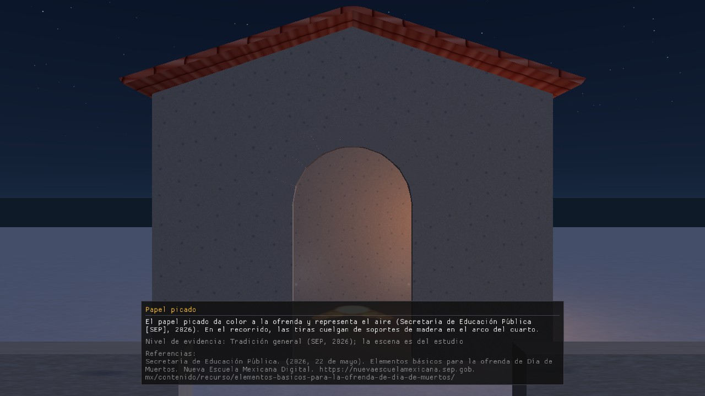

# 1. Qué es el recorrido y qué necesitas

## 1.1 Qué es
Un recorrido virtual 3D en primera persona del Día de Muertos en Mazunte, Oaxaca: caminas de la playa
al panteón y entras a un cuarto con una ofrenda. *(Alcance: `docs/CONTEXTO_PROYECTO.md`.)*

## 1.2 Qué necesitas
| Requisito | Valor | Estado |
|---|---|---|
| Sistema | Windows, **solo 64 bits (x64)** | Real (CLAUDE.md §3) |
| Gráficos | Compatibles con **OpenGL 3.3** | Real |
| Resolución de la ventana | **1280 × 720** (fija en el código) | Real (`WIDTH, HEIGHT`) |
| Rendimiento esperado | ≥ 30 FPS en una laptop con gráficos integrados | **Objetivo, sin medir** en ese equipo (ver `manual_tecnico/08_pruebas_y_rendimiento.md` §8.2.1) |
| Teclado y ratón | Sí | Real |
| Sonido | Opcional: si no hay tarjeta de sonido o faltan los archivos de `Audio/`, el programa avisa en la consola y sigue sin audio | Real (`Audio.cpp`) |

## 1.3 Cómo abrirlo
**PENDIENTE (E-3, E-7).** Aquí irá: descomprimir el `.zip` publicado en el *Release* de GitHub y ejecutar `NierikaStudio.exe`.
El script que arma el paquete existe (`tools/empaquetar_release.ps1`, E-3) pero el `.zip` todavía no se publicó ni se probó en otra PC.
Hasta entonces el programa se compila desde Visual Studio 2022 (ver `README.md` de la raíz).

## 1.4 Qué ves al abrir
La ventana se titula *Nierika Studio - Recorrido virtual: Dia de Muertos en Mazunte* y, tras unos instantes, agrega los cuadros por segundo (`NNN FPS`).
El cursor desaparece (ver sección 2). La cámara empieza en el **panteón**, en la posición (0, 1.6, 6) m: 6 m al frente del cuarto, a la altura de los ojos de una persona (1.6 m).
Ese punto queda bajo el papel picado, así que **la primera ficha que aparece es la del papel picado** (ver sección 4).

*Captura tomada el 12/11/2026 con el código de `develop` (con B-13, D-5 y E-2 ya fusionados), en un renderizador por software; con tu equipo se verá igual en forma, pero más fluido. Se vuelve a tomar en la PC de D2 con el aspecto final.*
