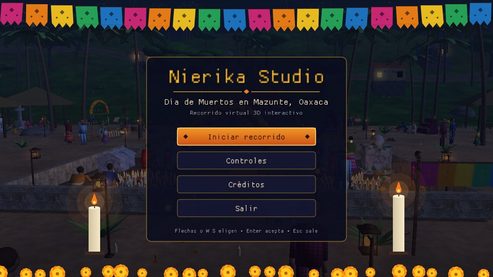
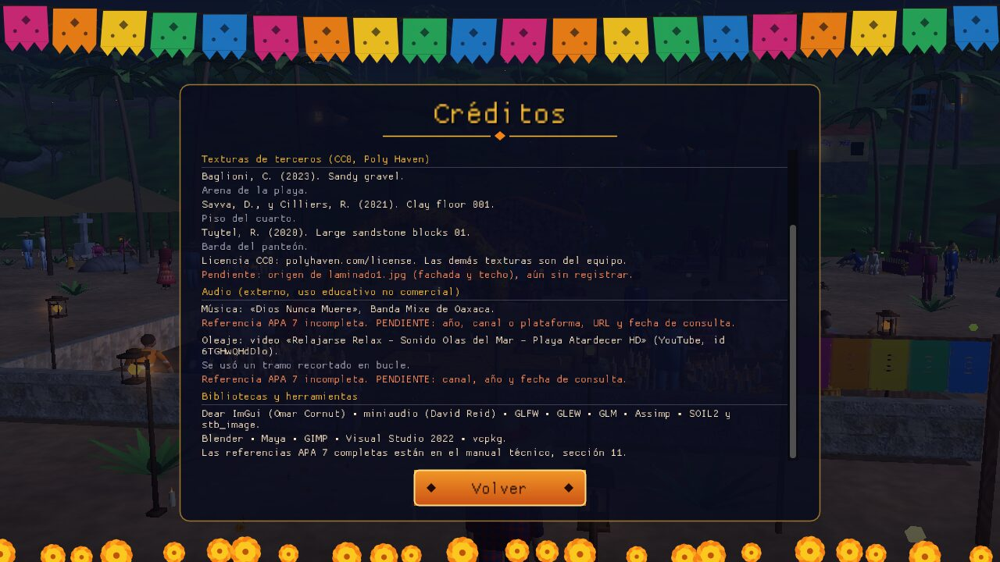
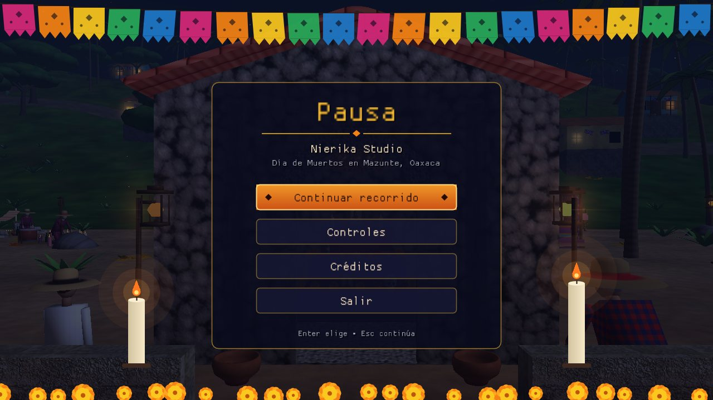

# 1. Qué es el recorrido y cómo abrirlo

## 1.1 Qué es

**Recorrido virtual: Día de Muertos en Mazunte** es una experiencia 3D en primera persona, en tiempo real, hecha por Nierika Studio (Equipo 15). Empieza al atardecer en la playa de Mazunte, Oaxaca, donde se ofrendan velas y flores de cempasúchil al mar, y te lleva por el panteón hasta un cuarto con una ofrenda de tres niveles. Caminas libremente, escuchas el mar y la música de una banda de viento, abres fichas con la explicación cultural de cada elemento (con su fuente) o dejas que un recorrido narrado te lleve por 12 estaciones.

Este manual explica cómo **ejecutarla**, **moverte** e **interactuar**. Si buscas cómo está hecha por dentro, consulta el Manual técnico.

## 1.2 Qué necesitas

| Requisito | Valor |
|---|---|
| Sistema operativo | Windows de 64 bits |
| Gráficos | Cualquier tarjeta compatible con **OpenGL 3.3** (basta la gráfica integrada del procesador) |
| Pantalla | La ventana mide **1280 × 720** píxeles y no cambia de tamaño |
| Teclado y ratón | Sí (se necesitan los dos) |
| Sonido | Recomendado, pero opcional: sin salida de audio el programa funciona sin sonido |
| Rendimiento | El equipo midió el programa en una laptop con procesador Intel Core i5 de 11.ª generación y **gráficos integrados**: mínimo 45 y promedio de unos 60 cuadros por segundo. En una tarjeta gráfica dedicada midió entre 200 y 340 |

## 1.3 Cómo abrirlo

Esta entrega es el **proyecto de Visual Studio 2022** (código fuente, modelos, shaders y audio en el repositorio de la sección 6). **No se entrega un ejecutable ni un `.zip`:** la forma de abrirlo es compilarlo.

1. Instala **Visual Studio 2022** con la carga de trabajo *Desarrollo de escritorio con C++*.
2. Instala **vcpkg** una sola vez (`git clone https://github.com/microsoft/vcpkg C:\vcpkg`, luego `C:\vcpkg\bootstrap-vcpkg.bat` y `C:\vcpkg\vcpkg integrate install`). Las bibliotecas Assimp, GLFW, GLEW y GLM se descargan solas al compilar la primera vez (unos 10 a 20 minutos).
3. Abre `NierikaStudio.sln`, elige **Release | x64** y pulsa **F5**. El ejecutable queda en `build/x64/Release/`.

Si el programa compilado se mueve a otra carpeta, `NierikaStudio.exe` debe estar **junto a las carpetas `Models`, `Shaders` y `Audio`** (el programa las busca ahí). Si Windows avisa que falta `VCRUNTIME140.dll` o `MSVCP140.dll`, instala el *Microsoft Visual C++ Redistributable* de 64 bits (gratuito, de Microsoft).

Al abrirlo, la primera pantalla es el menú de inicio.

## 1.4 Menú de inicio

Al abrir el programa aparece un **menú de inicio** sobre la escena, que gira despacio de fondo. La silueta, el recorrido y la música todavía no empiezan.

| Botón | Qué hace |
|---|---|
| **Iniciar recorrido** | Comienza la experiencia en el panteón: empieza a sonar el audio y la silueta inicia su caminata |
| **Controles** | Muestra la lista de teclas |
| **Créditos** | Muestra el equipo y todas las referencias del proyecto en formato APA 7 (se baja con la rueda del ratón o las flechas) |
| **Salir** | Cierra el programa |

Se elige con clic o con las flechas y **Enter**. En este menú, **Esc** cierra el programa.

## 1.5 Qué ves al empezar

La ventana se titula *Nierika Studio - Recorrido virtual: Dia de Muertos en Mazunte* y, tras unos instantes, agrega los cuadros por segundo (por ejemplo, `60 FPS`). El cursor desaparece: el ratón ahora controla la cámara. Empiezas en el **panteón**, a 6 metros del cuarto del cementerio, con la altura de los ojos de una persona (1.6 m). Como estás bajo el papel picado, lo primero que aparece es la ficha del papel picado.

*Si quieres volver al menú en cualquier momento, pulsa **Esc**: abre la pausa (Continuar recorrido, Controles, Créditos, Salir).*

