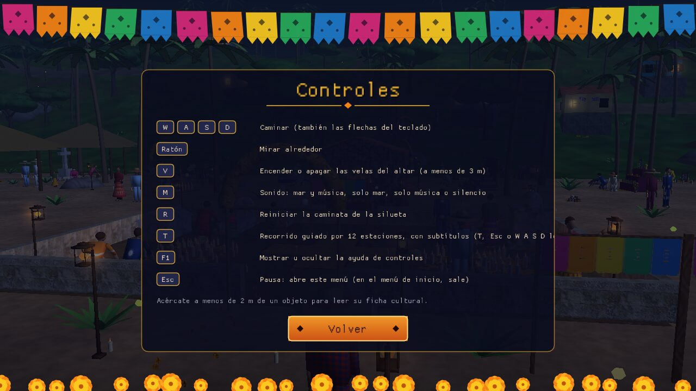

# 2. Controles

> **Estado: real.** Tomado de `src/main.cpp` (`DoMovement`, `KeyCallback`, `MouseCallback`) en `develop`.

## 2.1 Controles para el visitante

| Acción | Tecla / dispositivo | Qué hace |
|---|---|---|
| Avanzar / retroceder | **W** / **S**, o flechas **↑** / **↓** | Mueve la cámara hacia donde miras / en sentido contrario |
| Moverse a los lados | **A** / **D**, o flechas **←** / **→** | Mueve la cámara a la izquierda / derecha |
| Mirar alrededor | **Ratón** | Gira la cámara. El cursor queda oculto y atrapado en la ventana |
| Velas del altar | **V** (a menos de 3 m del altar) | Enciende o apaga las velas del altar: la luz cálida y las llamas suben o bajan en un cuarto de segundo. Lejos del altar solo muestra un aviso |
| Sonido | **M** | Cambia entre «mar y música», «solo el mar», «solo la música» y «silencio» (se avisa arriba en pantalla) |
| Ayuda de controles | **F1** | Muestra u oculta la lista de controles |
| Recorrido guiado | **T** | Una visita narrada por 12 estaciones (playa, ofrendas, altar, camino de las ánimas, mirador), con subtítulos y, si existen los audios, con voz. **T**, **Esc** o **W A S D** la cancelan y te dejan donde estás (ver `docs/RECORRIDO_GUIADO.md`) |
| Reiniciar la silueta | **R** | La silueta vuelve a la orilla y repite su caminata y la flor |
| Pausa / menú | **Esc** | Con el recorrido guiado activo, la primera pulsación solo lo cancela. Si no, abre el menú de pausa (Continuar, Controles, Créditos, Salir); otra vez **Esc** continúa. En el menú de inicio, **Esc** sale |

Notas verificadas en el código (`Camera.h`, `Colisiones.cpp`, `main.cpp`):
- La velocidad al caminar es de **2.0 m/s** (`SPEED` en `Camera.h`) y la sensibilidad del ratón es **0.25**.
- Se camina **solo en el plano horizontal**: mirar hacia arriba o abajo no te hace volar; los ojos van siempre a **1.6 m** sobre el suelo (que baja en la orilla).
- Hay **colisiones** (A-9): no atraviesas muros, bardas ni el altar; si chocas de frente te deslizas por el lado. La zona caminable llega hasta la orilla (z = 24).
- Al iniciar, las velas del altar están **encendidas**. Cerca del altar aparece arriba el recordatorio de **V**.
- Desde X-60 (17/11) la **barra espaciadora ya no hace nada**: las luces de colores se quitaron (ESTADO sec. 4, 17/11).
- Desde X-63 (17/11) **Esc ya no cierra el programa directamente**: abre la pausa. Para salir: Esc y luego «Salir» (clic o Enter). En el menú de inicio, Esc sí sale.
- En los menús el cursor reaparece y se puede hacer clic; también sirven las flechas (o W S) y Enter. En Créditos, flechas arriba/abajo o la rueda del ratón desplazan el texto.
- **T** (X-62, 17/11): durante el recorrido guiado el ratón no mueve la cámara. No se compiló en VS 2022 al escribir esta nota.

## 2.2 Teclas sin función

Desde X-61 (17/11) se quitaron del código la tecla **L** (cubos de las luces) y las teclas de depuración del reflector de la cruz (`T G Y H U J` y `1`–`6`). La barra espaciadora tampoco hace nada. Solo funcionan las teclas de la tabla de arriba.

## 2.3 Controles futuros (PENDIENTES, no existen todavía)

| Tarea | Posible control | Estado |
|---|---|---|
| C-7 (fichas) | Ninguno: la ficha aparece sola a **menos de 2 m** del objeto | Implementado (ver sección 4); falta compilar con ImGui en VS y probar |
| D-2 / D-4 (silueta) | Arranca sola al abrir el programa; **R** la reinicia | Implementado (D-5, fusionado el 12/11); falta que D2 lo acepte al verlo |

*Esquema dibujado por el equipo con `tools/x15_esquema_teclado.py`; no usa imágenes ajenas.*

## 2.4 Cómo se ven V y F1

Velas del altar apagadas con **V** (arriba, el aviso para volver a encenderlas):

Lista de controles que muestra **F1**:

*Capturas del 17/11/2026 en la PC de D2 (con las variables `NIERIKA_UI=velas_apagadas` y `NIERIKA_UI=ayuda` del modo de captura; el juego muestra lo mismo al pulsar las teclas).*

Misma lista en el menú de inicio (botón **Controles**):

*Captura del 17/11/2026 en Linux (X-63); falta verla en la PC de D2.*
