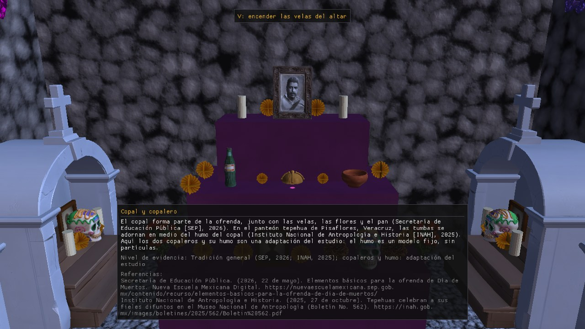
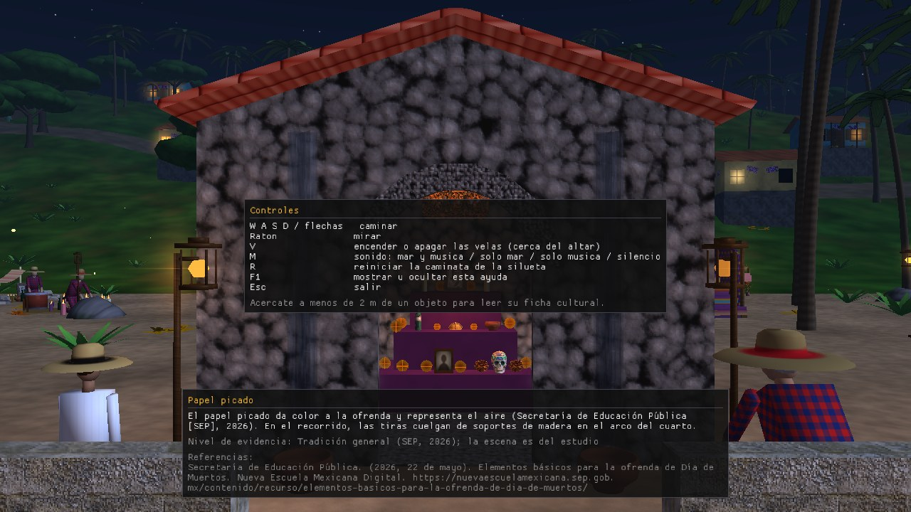

# 2. Controles

## 2.1 Tabla de controles

| Acción | Tecla o dispositivo | Qué hace |
|---|---|---|
| Avanzar / retroceder | **W** / **S**, o flechas **↑** / **↓** | Mueve la cámara hacia donde miras / en sentido contrario |
| Moverse a los lados | **A** / **D**, o flechas **←** / **→** | Desplaza la cámara a la izquierda / derecha |
| Mirar alrededor | **Ratón** | Gira la cámara. El cursor queda oculto dentro de la ventana |
| Recorrido guiado | **T** | Inicia una visita narrada de 12 estaciones con subtítulos y voz. **T**, **Esc** o **W A S D** la cancelan y te dejan donde estás |
| Velas del altar | **V** (a menos de 3 m del altar) | Enciende o apaga las velas del altar: la luz cálida y las llamas cambian en un cuarto de segundo |
| Sonido | **M** | Cambia entre «mar y música», «solo el mar», «solo la música» y «silencio» (un aviso lo indica arriba) |
| Ayuda | **F1** | Muestra u oculta la lista de controles |
| Reiniciar la silueta | **R** | La silueta vuelve a la orilla y repite su caminata y la flor |
| Pausa / menú | **Esc** | Abre la pausa. Si el recorrido guiado está activo, la primera pulsación solo lo cancela |

Solo funcionan las teclas de esta tabla; el resto no hace nada.

## 2.2 Cómo se mueve la cámara

- Caminas a **2.0 m/s**. Mirar hacia arriba o abajo no te hace volar: te mueves solo sobre el suelo, con los ojos siempre a 1.6 m de altura (el suelo baja hacia la orilla y sube en las colinas).
- Hay **colisiones**: no atraviesas muros, bardas, el altar ni las construcciones; si chocas de frente, te deslizas por el lado. Usa las puertas: la barda del panteón tiene dos de 2 m y el cuarto tiene una al frente.
- Puedes caminar por toda la playa, el panteón, el cuarto y las colinas de los lados. La orilla es el límite hacia el mar.

## 2.3 Cómo se ven V y F1

Velas del altar apagadas con **V** (arriba, el aviso para volver a encenderlas):

Lista de controles que muestra **F1**:

## 2.4 En los menús

En el menú de inicio, el de pausa y los créditos, el cursor aparece y puedes hacer clic. También sirven las flechas (o W S) y **Enter**. En Créditos, las flechas arriba y abajo o la rueda del ratón desplazan el texto. En la pausa, **Esc** continúa el recorrido.

