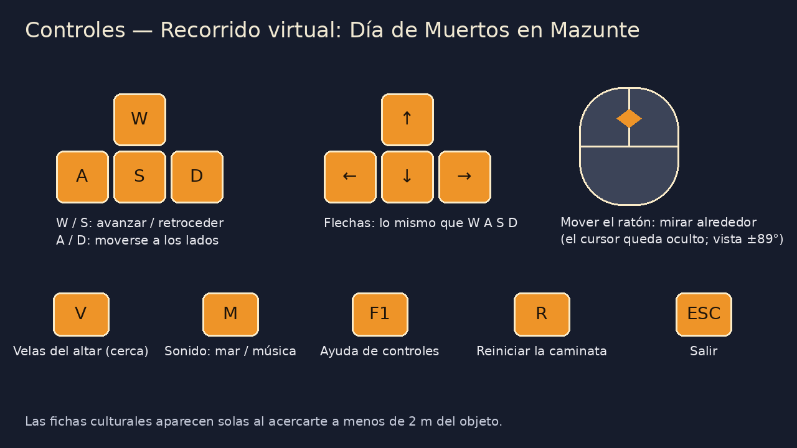

# 2. Controles

> **Estado: real.** Tomado de `src/main.cpp` (`DoMovement`, `KeyCallback`, `MouseCallback`) en `develop`.

## 2.1 Controles para el visitante

| Acción | Tecla / dispositivo | Qué hace |
|---|---|---|
| Avanzar / retroceder | **W** / **S**, o flechas **↑** / **↓** | Mueve la cámara hacia donde miras / en sentido contrario |
| Moverse a los lados | **A** / **D**, o flechas **←** / **→** | Mueve la cámara a la izquierda / derecha |
| Mirar alrededor | **Ratón** | Gira la cámara. El cursor queda oculto y atrapado en la ventana |
| Velas del altar | **V** (a menos de 3 m del altar) | Enciende o apaga las velas del altar: la luz cálida y las llamas suben o bajan en un cuarto de segundo. Lejos del altar solo muestra un aviso |
| Sonido | **M** | Cambia entre «mar y música», «solo el mar», «solo la música» y «silencio» (se avisa arriba en pantalla) |
| Ayuda de controles | **F1** | Muestra u oculta la lista de controles |
| Ver dónde están las luces | **L** | Muestra u oculta los cubos blancos que marcan las luces |
| Reiniciar la silueta | **R** | La silueta vuelve a la orilla y repite su caminata y la flor |
| Salir | **Esc** | Cierra el programa |

Notas verificadas en el código (`Camera.h`, `Colisiones.cpp`, `main.cpp`):
- La velocidad al caminar es de **2.0 m/s** (`SPEED` en `Camera.h`) y la sensibilidad del ratón es **0.25**.
- Se camina **solo en el plano horizontal**: mirar hacia arriba o abajo no te hace volar; los ojos van siempre a **1.6 m** sobre el suelo (que baja en la orilla).
- Hay **colisiones** (A-9): no atraviesas muros, bardas ni el altar; si chocas de frente te deslizas por el lado. La zona caminable llega hasta la orilla (z = 24).
- Al iniciar, las velas del altar están **encendidas**. Cerca del altar aparece arriba el recordatorio de **V**.
- Desde X-60 (17/11) la **barra espaciadora ya no hace nada**: las luces de colores se quitaron (ESTADO sec. 4, 17/11).
- Con Esc se cierra el programa directamente, sin pedir confirmación.

> **Dudas para revisar con D2 antes de publicar** (no confirmadas en el código):
> 1. La tecla **L** está descrita en el código como "ayuda de depuración". ¿Se queda para el visitante o sale antes de la entrega?

## 2.2 Teclas que NO entran al manual

En el código existen estas teclas, pero son de **depuración** (mueven y orientan el reflector de la cruz) y
deberían salir antes de la entrega; por eso **no se documentan para el visitante**. **E-2 no las retiró**: siguen en `main.cpp` (líneas 643–654 al 12/11) y la decisión de quitarlas queda **pendiente de D2**:

`T G Y H U J` (posición del reflector) · `1 2 3 4 5 6` (dirección del reflector)

Si no salen, hay que agregarlas aquí.

## 2.3 Controles futuros (PENDIENTES, no existen todavía)

| Tarea | Posible control | Estado |
|---|---|---|
| C-7 (fichas) | Ninguno: la ficha aparece sola a **menos de 2 m** del objeto | Implementado (ver sección 4); falta compilar con ImGui en VS y probar |
| D-2 / D-4 (silueta) | Arranca sola al abrir el programa; **R** la reinicia | Implementado (D-5, fusionado el 12/11); falta que D2 lo acepte al verlo |

*Esquema dibujado por el equipo con `tools/x15_esquema_teclado.py`; no usa imágenes ajenas.*
