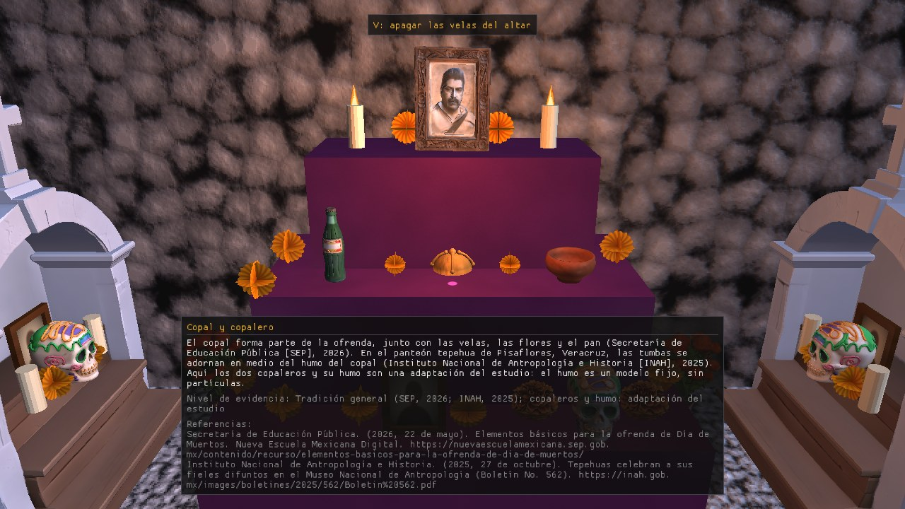
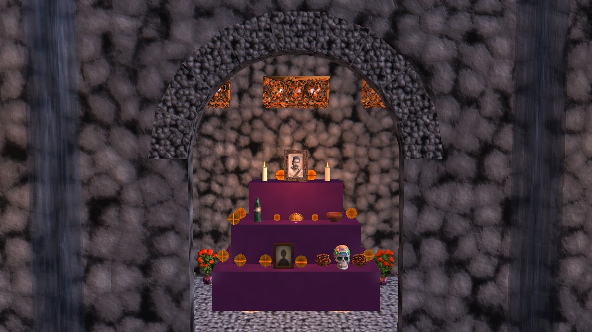
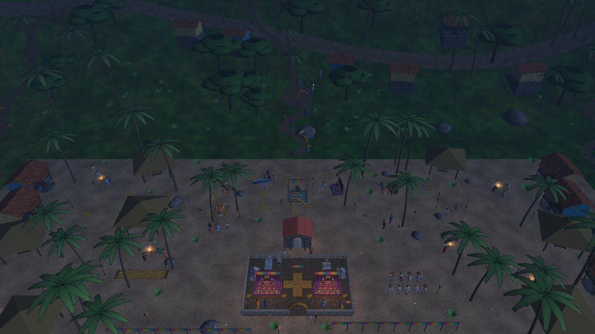
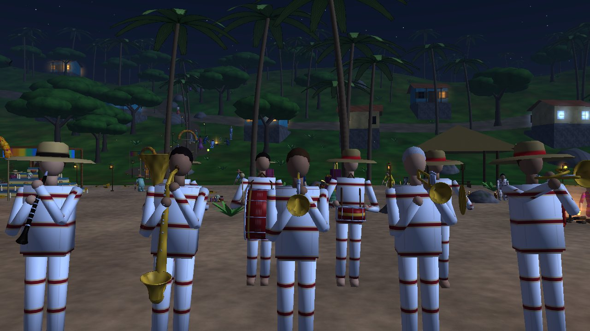
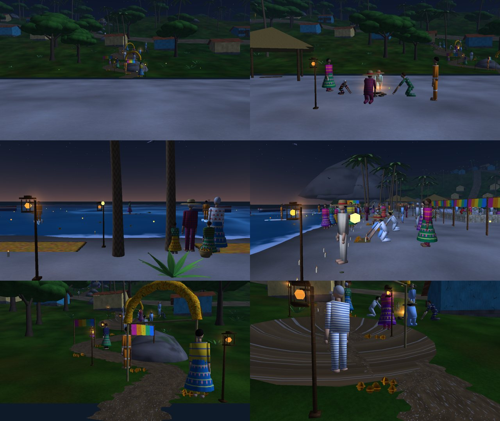
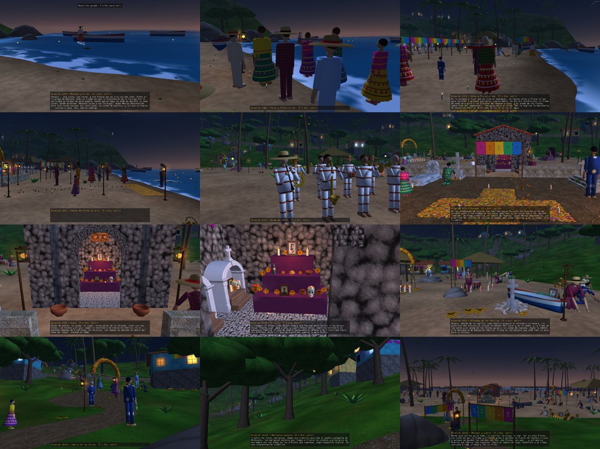

# 3. El recorrido

Hay dos maneras de recorrer la experiencia: **libre** (tú decides a dónde ir) y **guiada** (tecla **T**).

## 3.1 Recorrido libre: paradas sugeridas

| # | Parada | Qué verás |
|---|---|---|
| 1 | Llegada a la playa | Arena y mar con **olas** que se mueven, cielo nocturno con luna y estrellas |
| 2 | Orilla | **Velas** con llama que parpadea y **flores** de cempasúchil flotando sobre el agua; lanchas, la comparsa y una anfitriona que te recibe |
| 3 | Camino al panteón | La **silueta** camina de la orilla al cuarto (unos 18 s) por el eje central, pasando por las dos puertas de la barda |
| 4 | Panteón | Tumbas, cruz, roca, barda baja de piedra con dos puertas y **papel picado** colgado de dos postes |
| 5 | Cuarto del cementerio | Altar de 3 niveles al centro del cuarto, con velas, marco, botella, copalero, pan de muerto y cempasúchil; tumbas-capilla con su nicho en los muros; la silueta deja una flor en la repisa |

**Qué hace la silueta.** Al elegir «Iniciar recorrido» camina desde la orilla hasta el cuarto, extiende el brazo derecho, suelta una flor de cempasúchil que cae en la repisa del altar y se queda quieta. La tecla **R** la reinicia.

## 3.2 Más para explorar

Además de esas cinco paradas, la playa y las colinas tienen otros elementos que conviene visitar. Cada uno tiene su ficha (sección 4):

- **Banda de viento**, con nueve músicos que tocan al compás; de ella sale la música que oyes.
- **Ofrendas de las familias** en la playa: 14 ofrendas distintas, con personas de rodillas junto a ellas.
- **Comparsa** de peregrinos en la orilla oeste y un **baile familiar** cerca de la banda.
- **Camino de las ánimas**: un sendero con faroles y pétalos hacia el norte, y las **mariposas monarca** en las colinas.
- **Tortugas de Mazunte**, en la orilla este.
- Las **colinas** se pueden subir; tienen casas con ventanas encendidas, fogatas y luciérnagas.

## 3.3 Recorrido guiado (tecla T)

Pulsa **T** en cualquier momento y una cámara te lleva por **12 estaciones**, con una narración de voz y subtítulos. Dura unos 6 minutos y medio. Durante el recorrido el ratón no mueve la cámara y no aparecen las fichas (los subtítulos cuentan lo mismo). Para salir, pulsa **T**, **Esc** o cualquier tecla de movimiento (**W A S D**): la cámara queda donde estés y vuelves al recorrido libre.

| # | Estación |
|---|---|
| 1 | Mazunte y el mar (la apertura, junto a las tortugas) |
| 2 | Velas y flores al mar |
| 3 | Comparsa en la orilla |
| 4 | Camino de flores al arco |
| 5 | Banda de viento |
| 6 | Panteón |
| 7 | Copal |
| 8 | El altar (la silueta llega con la cámara y deja su flor) |
| 9 | Ofrendas de las familias |
| 10 | Camino de las ánimas |
| 11 | Mariposas |
| 12 | Mirador y cierre |

## 3.4 Nota cultural

Lo que es **adaptación del estudio** y no tradición documentada se dice igual en las fichas. Por ejemplo, el cuarto del cementerio, los músicos y la coreografía del baile son una representación de Nierika Studio, no una réplica de un lugar o un grupo real.
