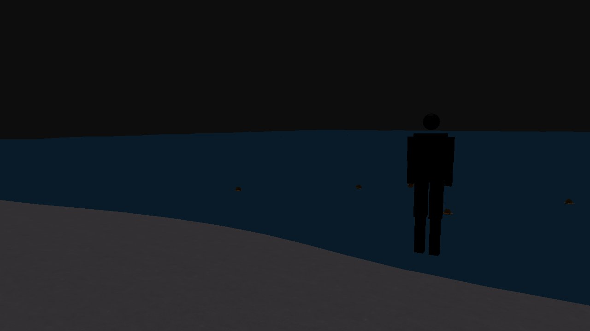
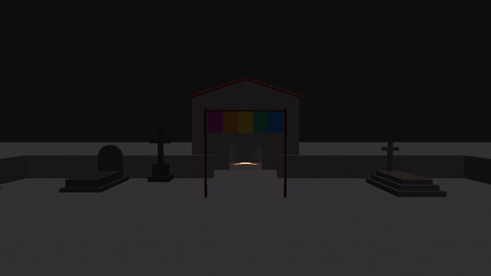
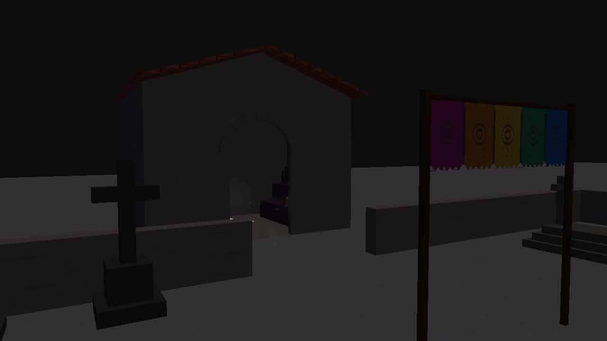
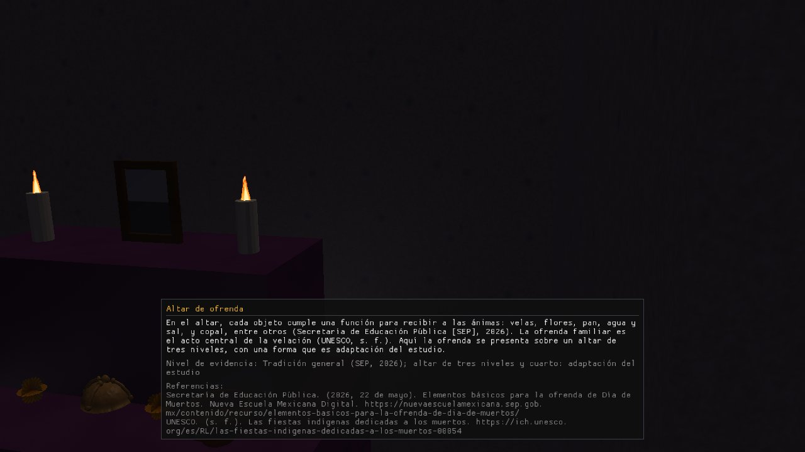
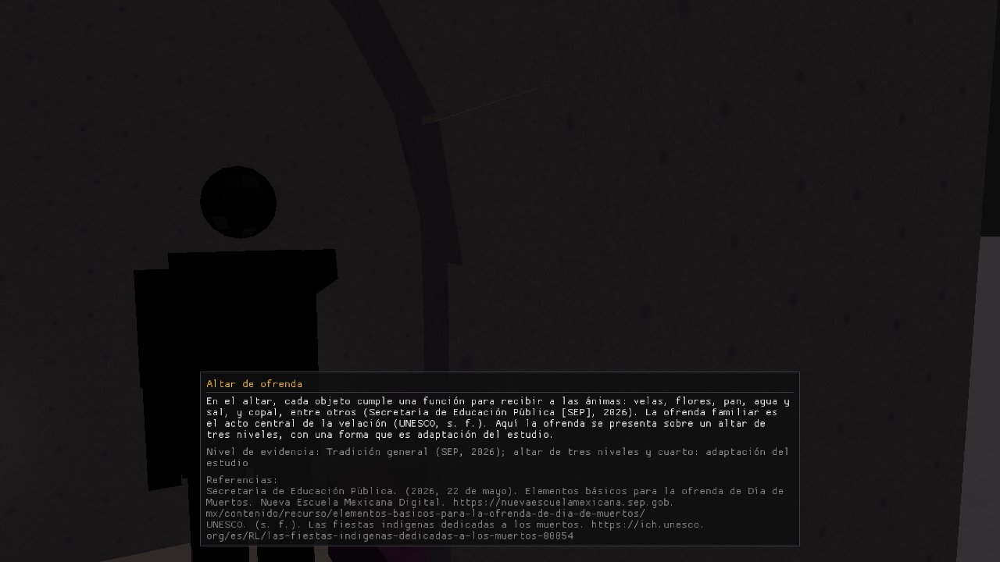

# 3. El recorrido, parada por parada

> Base: `docs/CONTEXTO_PROYECTO.md` §5. La columna "Hoy" indica qué existe en el programa (código de `develop` del 12/11 más los
> PR abiertos de B-13, D-5, E-2 y C-6, que cambian el cuarto y la barda). Las capturas son de ese código; se vuelven a tomar al fusionarse.

| # | Parada | Qué verás | Hoy |
|---|---|---|---|
| 1 | Llegada a la playa | Arena y mar con **olas** (suma de 3 senos) | Existe |
| 2 | Orilla | **Velas** con llama que parpadea y **flores** flotando sobre el agua; fichas de velas y cempasúchil | Existe (la silueta sale de aquí al empezar) |
| 3 | Sendero al panteón | La **silueta** camina de la orilla al cuarto (18 s) por el eje central, pasando por las dos puertas de la barda | Existe; las puertas de la barda llegan con el PR de E-2 |
| 4 | Panteón | 4 tumbas, cruz, roca, barda baja de piedra con dos puertas, **papel picado** colgado de dos postes; ficha de papel picado | Existe |
| 5 | Cuarto del cementerio | Altar de 3 niveles contra el muro derecho con velas, marco, botella, copalero, pan de muerto y cempasúchil; la silueta deja una flor en la repisa; fichas de altar y pan de muerto | Existe (altar y colisiones en el PR de B-13) |

**Qué hace la silueta:** empieza sola al abrir el programa, camina unos 18 s desde la orilla hasta el cuarto, extiende el brazo derecho, suelta una flor de cempasúchil que cae en la repisa del altar y se queda quieta. La tecla **R** la reinicia.

## Nota cultural
Lo que sea adaptación del estudio y no tradición documentada se dice igual que en las fichas
(p. ej., el cuarto del cementerio es *adaptación del estudio*, según `CONTEXTO_PROYECTO.md` §5). Los textos salen de las fuentes de C-7a.
