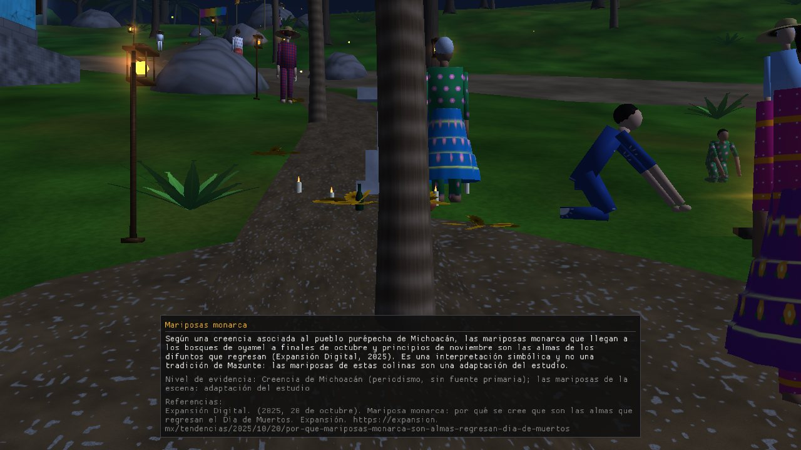

# 4. Fichas culturales y audio

## 4.1 Fichas culturales

Son **13** y aparecen **solas** en la parte baja de la ventana cuando estás a **menos de 2 metros** de un punto de la ficha. Si estás cerca de dos, sale la más cercana. Se van cuando te alejas. No se pueden cerrar ni mover: el ratón es de la cámara. Cada ficha muestra el título, un texto breve, el **nivel de evidencia** (tradición general, tradición local documentada o adaptación del estudio) y las **referencias en APA 7**.

| Ficha | Dónde está (metros del mundo: x, z) |
|---|---|
| Velas | Orilla, (−3, 23) |
| Flor de cempasúchil | Orilla, (3, 23) |
| Papel picado | Panteón, bajo los postes, (0, 6) |
| Altar de ofrenda | Cuarto, frente al altar, (0, −0.1) |
| Pan de muerto | Cuarto, sobre el altar, (0, −0.75) |
| Banda de viento | Frente a la banda, (12.6, 10.4) y (15.4, 10.4) |
| Copal y copalero | Cuarto, junto a cada copalero, (−1.05, 1.75) y (1.05, 1.75) |
| Panteón y tumbas | Al pie de las tumbas del panteón (cuatro puntos) |
| Ofrendas de las familias | Frente a cada una de las 14 ofrendas de la playa |
| Comparsa en la orilla | Orilla oeste, (−12, 22) |
| Camino de las ánimas | Sendero norte, (0.5, −28) |
| Mariposas monarca | Colinas del norte, (0, −37.5) |
| Tortugas de Mazunte | Orilla este, (21, 22.4) |

Las fuentes de cada ficha están en el menú **Créditos** y en el Manual técnico (secciones b y k).

## 4.2 Audio

Suenan dos pistas **en bucle** cuyo volumen cambia con tu posición:

- **Oleaje:** crece cuando te acercas al mar, de muy bajo en el panteón a su máximo en la orilla.
- **Música:** sale de la **banda de viento**. Se oye con fuerza a 3 m o menos de ella y baja con la distancia; si miras hacia otro lado, se mueve entre los parlantes izquierdo y derecho.

La tecla **M** cambia entre «mar y música», «solo el mar», «solo la música» y «silencio». Si tu equipo no tiene salida de audio o faltan los archivos de la carpeta `Audio`, el programa avisa en la consola y sigue sin sonido.

El **recorrido guiado** (tecla **T**) usa además una narración de voz sintetizada (12 archivos en `Audio/narracion/`); si faltan, se muestran solo los subtítulos.
