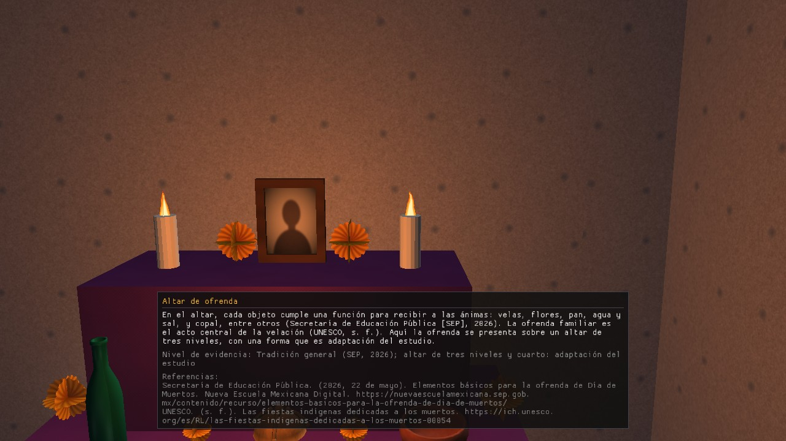

# 4. Fichas culturales y audio

## 4.1 Fichas culturales (C-7)
Son **5**, hechas con Dear ImGui: velas, flor de cempasúchil, papel picado, altar de ofrenda y pan de muerto.
Aparecen **solas** en la parte baja de la ventana cuando estás a **menos de 2 m** (en el suelo, en horizontal) del punto de la ficha; si estás cerca de dos, sale **la más cercana**.
Se van cuando te alejas. No se pueden cerrar ni mover (el ratón no interactúa con ellas).
Cada ficha muestra: el título, un texto breve, el **nivel de evidencia** (tradición general, local documentado o adaptación del estudio) y las **referencias en APA 7**.

| Ficha | Dónde (m, mundo) |
|---|---|
| Velas | orilla, (−3, 23) |
| Flor de cempasúchil | orilla, (3, 23) |
| Papel picado | panteón, bajo los postes, (0, 6) |
| Altar de ofrenda | cuarto, costado del altar, (1.35, 0.6) |
| Pan de muerto | cuarto, sobre el altar, (1.40, 0) |

*(Según `src/Fichas.cpp` de `develop` con B-13; los textos son los de `docs/fichas_culturales.md`, que siguen **por verificar contra la fuente**. Falta compilar con ImGui en Visual Studio y verlas en pantalla.)*

## 4.2 Audio (D-6)
Suenan dos pistas **en bucle**: el oleaje (volumen 0.60) y una música lejana tranquila (0.25). Son propias del estudio, generadas con código (`tools/d6_audio.py`).
**No hay control de volumen ni de silencio**: no está definido en el plan. Si el equipo no tiene salida de audio, el programa sigue sin sonido.
**No se pudo comprobar cómo suena** en el entorno donde se escribió este manual.
