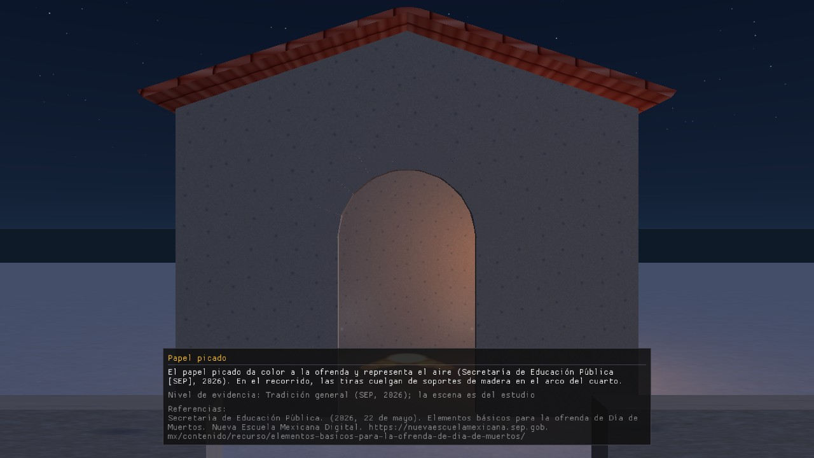

# 1. What the tour is and what you need

## 1.1 What it is
A first-person 3D virtual tour of the Day of the Dead in Mazunte, Oaxaca: you walk from the beach to the cemetery and enter a room with an offering (*ofrenda*). *(Scope: `docs/CONTEXTO_PROYECTO.md`.)*

## 1.2 What you need
| Requirement | Value | Status |
|---|---|---|
| System | Windows, **64-bit only (x64)** | Real (CLAUDE.md §3) |
| Graphics | **OpenGL 3.3** compatible | Real |
| Window size | **1280 × 720** (fixed in the code) | Real (`WIDTH, HEIGHT`) |
| Expected performance | ≥ 30 FPS on a laptop with integrated graphics | **Target, not measured** on such a machine (see `manual_tecnico/en/08_testing_and_performance.md` §8.2.1) |
| Keyboard and mouse | Yes | Real |
| Sound | Optional: with no sound card or missing `Audio/` files the program warns in the console and runs without audio | Real (`Audio.cpp`) |

## 1.3 How to open it
**PENDING (E-3, E-7).** This will explain: unzip the `.zip` published in the GitHub *Release* and run `NierikaStudio.exe`. The script that builds the package exists (`tools/empaquetar_release.ps1`, E-3), but the `.zip` has not yet been published or tested on another PC. Until then the program is built from Visual Studio 2022 (see the root `README.md`).

## 1.4 What you see when it opens
The window is titled *Nierika Studio - Recorrido virtual: Dia de Muertos en Mazunte* and, after a moment, adds the frames per second (`NNN FPS`). The cursor disappears (see section 2). The camera starts in the **cemetery** at position (0, 1.6, 6) m: 6 m in front of the room, at human eye height (1.6 m). That spot is under the papel picado, so **the first card to appear is the papel picado card** (see section 4).

*Screenshot taken on Nov 12, 2026 with `develop` code (B-13, D-5 and E-2 merged) in a software renderer; on your machine it will look the same in shape but smoother. It will be retaken on D2's PC with the final look.*
