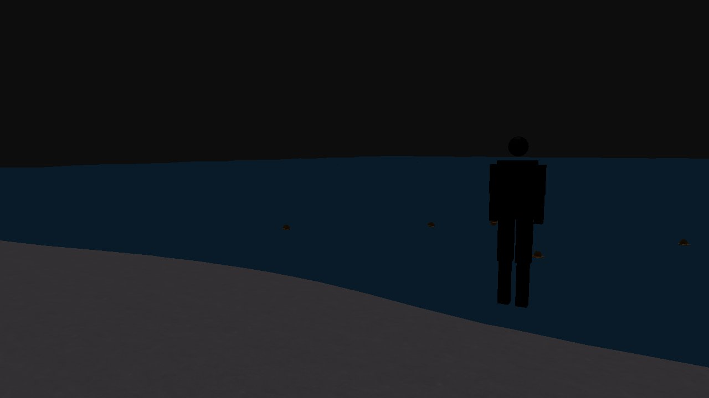
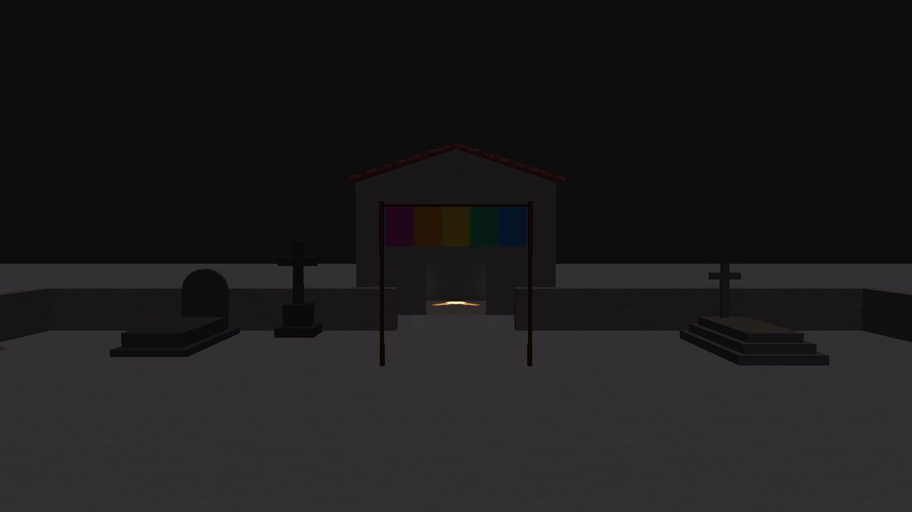
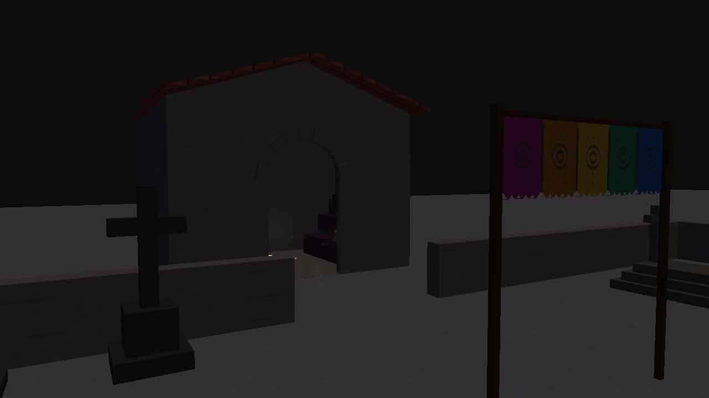
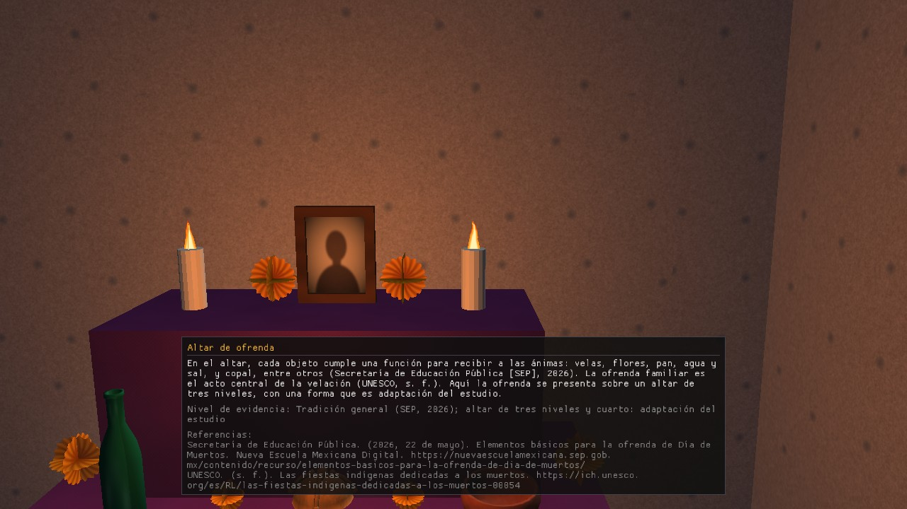
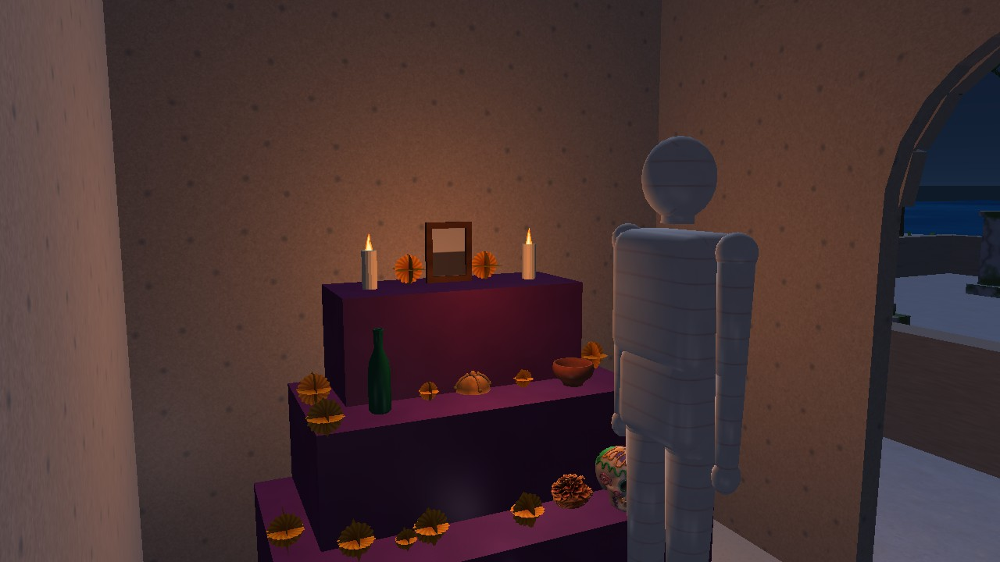

# 3. The tour, stop by stop

> Base: `docs/CONTEXTO_PROYECTO.md` §5. The "Today" column says what exists in the program (`develop` code of Nov 12, with B-13, D-5, E-2 and C-6 merged). Screenshots are from that code and will be repeated on D2's PC before delivery.

| # | Stop | What you will see | Today |
|---|---|---|---|
| 1 | Arrival at the beach | Sand and sea with **waves** (sum of 3 sines) | Exists |
| 2 | Shore | **Candles** with a flickering flame and **flowers** floating on the water; candle and marigold cards | Exists (the silhouette starts here) |
| 3 | Path to the cemetery | The **silhouette** walks from the shore to the room (18 s) along the central axis, through the two wall gates | Exists (the two wall gates are from E-2) |
| 4 | Cemetery | 4 tombs, cross, rock, low stone wall with two gates, **papel picado** hung from two posts; papel picado card | Exists |
| 5 | Cemetery room | 3-level altar against the right wall with candles, frame, bottle, copal burner, pan de muerto and marigolds; the silhouette leaves a flower on the ledge; altar and pan de muerto cards | Exists (B-13) |

**What the silhouette does:** it starts by itself when the program opens, walks about 18 s from the shore to the room, extends its right arm, drops a marigold that falls onto the altar ledge, and stays still. Key **R** restarts it.

## Cultural note
What is a studio adaptation and not documented tradition is said the same way as in the cards (e.g., the cemetery room is a *studio adaptation*, per `CONTEXTO_PROYECTO.md` §5). Texts come from the C-7a sources.
