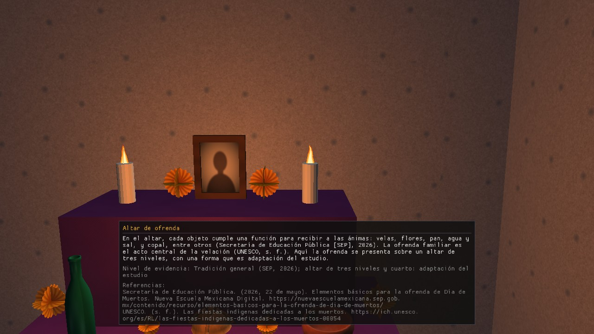

# 4. Cultural cards and audio

## 4.1 Cultural cards (C-7)
There are **5**, made with Dear ImGui: candles, marigold flower, papel picado, offering altar and pan de muerto. They appear **by themselves** at the bottom of the window when you are within **2 m** (on the ground, horizontally) of the card's point; if you are near two, **the nearest** shows. They disappear when you walk away. They cannot be closed or moved (the mouse does not interact with them). Each card shows: the title, a short text, the **evidence level** (general tradition, documented local, or studio adaptation) and the **APA 7 references**.

| Card | Where (m, world) |
|---|---|
| Candles | shore, (−3, 23) |
| Marigold flower | shore, (3, 23) |
| Papel picado | cemetery, under the posts, (0, 6) |
| Offering altar | room, beside the altar, (1.35, 0.6) |
| Pan de muerto | room, on the altar, (1.40, 0) |

*(According to `src/Fichas.cpp` in `develop` with B-13; texts are those of `docs/fichas_culturales.md`, still **to be verified against the source**. Not yet compiled with ImGui in Visual Studio or seen on screen.)*

## 4.2 Audio (D-6)
Two **looping** tracks play: the sea waves (volume 0.60) and calm distant music (0.25). They are the studio's own, generated with code (`tools/d6_audio.py`). **There is no volume or mute control**: it is not defined in the plan. If the machine has no audio output, the program runs without sound. **How it sounds could not be checked** in the environment where this manual was written.
